<div align="center">

# ⬡ Agile-HQ-PQC

### Adaptive Quantum-Safe Security and Privacy for Healthcare Data

**CADA-AASM** · *Context-Aware Dynamic Agility and Adaptive Anonymization Steering Matrix*


M.Tech (CSE – Cybersecurity) project · **Jose Rohit M** · Guide: **Dr. Karthikeyan Jayaraman** · SCORE, VIT Vellore

</div>

> [!IMPORTANT]
> Transport-crypto strength (hybrid post-quantum cryptography) **and** data-privacy strength (differential privacy, (K, L)-anonymity) are steered as **one joint control problem** by a live latency budget
> **`L = 200 − RTT − 0.5 · CPU`**,
> while raw clinical telemetry is **never** allowed below NIST security Category 3.

<p align="center">
  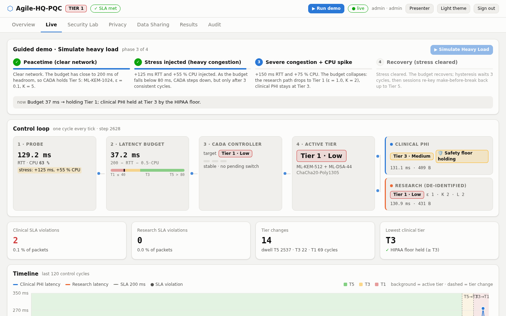
  <br><sub><i>The Live tab mid-demo: severe congestion has pushed the research stream to Tier 1, while the safety floor holds clinical PHI at Tier 3.</i></sub>
</p>

> **A gateway that picks the strongest post-quantum protection and privacy the network can currently afford, and never lets raw patient data fall below NIST Category 3.**

---

## Abstract

This project treats quantum-safe transport security and data privacy as one latency-constrained trade-off, and builds a gateway that picks the strongest protection the network can currently afford.

A controller, CADA-AASM, computes a live latency budget L = 200 − RTT − 0.5 · CPU and maps it to one of three tiers. Each tier fixes together a post-quantum key-encapsulation parameter set, a signature parameter set, a data cipher, a differential-privacy parameter ε and anonymity parameters K and L. A three-cycle persistence filter prevents cipher flapping, and raw clinical telemetry is held at NIST Category 3 or above whatever the congestion. Sessions are re-keyed make-before-break, and post-quantum signatures are batched per epoch.

In 30 paired trials under an emulated congestion model, steering cut SLA violations during stress against static Tier 5 (clinical 7.4% to 4.1%, research 6.9% to 2.9%, p < 10⁻⁴) and cut tier changes by 65%. A real-link validation, using Linux network namespaces, kernel bandwidth shaping and real TCP, did **not** reproduce that gain at 2 Mbit/s and above. It showed that adaptation matters only on very thin links: at 0.5 Mbit/s static Tier 5 failed on every cycle, adaptive on 13%, and static Tier 3 on none. The distinctive contribution is therefore the joint, safe adaptation of cryptographic and privacy parameters under a compliance floor, not a latency win. The system is open, software-only and covered by 250 automated tests (65 core integration + 185 KAT and tier security tests), with a React operator console.

## Research gap

Of the 18 IEEE Xplore papers surveyed (2023 to 2026, all read in full), none sets a differential-privacy or anonymity parameter together with a post-quantum suite. Run-time adaptation of post-quantum settings exists only in \[6\] (rule-based, one device) and \[10\] (UAV simulation), neither for healthcare and neither adapting privacy, and \[10\] lets its security floor drop under load. Adaptive privacy \[17\], \[18\], \[21\] reacts to training, not to network latency; \[21\] is theory only, and \[20\] sets its budgets once per dataset. The claimed gap is joint control of transport cryptography and privacy through one latency budget, with a hard floor for raw clinical data, evaluated on emulated and real shaped links. Adaptive PQC and adaptive privacy budgets are **not** claimed as novel. The survey was a single reviewer on IEEE Xplore only, so it is not a systematic review. Full text: [`docs/RELATED_WORK.md`](docs/RELATED_WORK.md) and [`docs/LITERATURE_REVIEW.md`](docs/LITERATURE_REVIEW.md).

| Group (reference numbers as in [`docs/REFERENCES.md`](docs/REFERENCES.md)) | Post-quantum | Privacy (DP or anonymity) | Adapts at run time | Crypto + privacy jointly | Compliance floor |
|---|:---:|:---:|---|:---:|:---:|
| PQC for healthcare \[4, 5, 8, 9\] | yes | no | no | no | no |
| PQC cost on networks \[7, 11–16\] | yes | no | no | no | no |
| Adaptive PQC \[6, 10\] | yes | no | yes | no | no (soft in \[10\]) |
| Privacy for medical data \[19, 20\] | no | yes | no (budgets set once per dataset in \[20\]) | no | no |
| Adaptive privacy \[17, 18, 21\] | no | yes | \[17\], \[18\] yes, in training; \[21\] yes, theory only | no | no |
| **This work** | **yes** | **yes** | **yes, from the latency budget** | **yes** | **yes** |

## Documents

| Document | What it is |
|---|---|
| [`docs/REPORT.md`](docs/REPORT.md) | The project report: problem, abstract, objectives, literature survey, design, evaluation and references |
| [`docs/Agile-HQ-PQC_presentation.pptx`](docs/Agile-HQ-PQC_presentation.pptx) | The presentation deck |
| [`docs/REFERENCES.md`](docs/REFERENCES.md) | All 32 references, numbered as in the report |
| [`Compiled_PDFs/Agile_HQ_PQC_Paper.pdf`](Compiled_PDFs/Agile_HQ_PQC_Paper.pdf) | The IEEE-style paper (source: [`LaTeX_Sources/paper.tex`](LaTeX_Sources/paper.tex)) |
| [`Compiled_PDFs/Agile_HQ_PQC_Patent.pdf`](Compiled_PDFs/Agile_HQ_PQC_Patent.pdf) | The patent draft (source: [`LaTeX_Sources/patent.tex`](LaTeX_Sources/patent.tex)) |

## Results at a glance

**Emulated link** (30 paired trials, staged calm, moderate, heavy, severe, calm):

| Comparison | Clinical violations | Research violations | Significance |
| --- | --- | --- | --- |
| Static Tier 5 | 7.4% | 6.9% | baseline |
| Adaptive (CADA-AASM) | 4.1% | 2.9% | p < 1e-4 vs Tier 5 |
| Adaptive vs static Tier 3 | not different | not different | p = 0.16 and 0.058 |

The persistence filter cut tier changes from 6.9 to 2.4 per run (65% fewer) and handshakes from 10.9 to 6.4. Batch signing cut wire size from about 5.0 kB to 0.9 kB with 1.1% violations. In the bandwidth and loss sweep, the gain reached about 45 percentage points at 1 Mbit/s. The clinical floor held in every trial.

**Real shaped link** (Linux namespaces, veth, kernel token-bucket shaping, real TCP; constant severe stress, clinical SLA-violation rate, from [`reports/testbed_report.md`](reports/testbed_report.md)):

| bandwidth | CADA-AASM | Static T5 | Static T3 |
|---|---|---|---|
| 5 Mbit/s | 0.0 % | 0.0 % | 0.0 % |
| 2 Mbit/s | 0.0 % | 0.0 % | 0.0 % |
| 1 Mbit/s | 3.3 % | 0.0 % | 0.0 % |
| 0.5 Mbit/s | 13.3 % | 100.0 % | 0.0 % |

Under staged stress, no configuration had a violation. Mean clinical p95 latency was 159.2 ms for adaptive, 164.8 ms for static Tier 5 and 159.2 ms for static Tier 3. The minimum clinical tier was 3 in every adaptive trial. Part B used 4 repetitions, so the smallest possible Wilcoxon p-value is 0.125 and these results are descriptive.

**Honest conclusion.** The emulated gain over static Tier 5 is not reproduced on a real link at 2 Mbit/s and above, where every configuration meets the budget. Adaptation matters only on very thin links, and a well-chosen static Tier 3 matches or beats it on latency. The defensible contribution is therefore the joint, safe adjustment of cryptography and privacy under a compliance floor, not a latency win.

## Limitations

The full list of deviations and caveats is in [`docs/LIMITATIONS.md`](docs/LIMITATIONS.md); see also [§20](#20-limitations-read-before-presenting). Two points matter most: the main evaluation's congestion is emulated, and **the real-link test does not charge post-quantum computation to latency** (paper \[7\] in the report found that computation, not bandwidth, caused the 4.7 times handshake penalty). All patient data is synthetic.

---

## Table of contents

1. [Overview](#1-overview)
2. [The problem](#2-the-problem)
3. [Key ideas and contributions](#3-key-ideas-and-contributions)
4. [System at a glance](#4-system-at-a-glance)
5. [Security tiers](#5-security-tiers)
6. [The CADA-AASM control loop](#6-the-cada-aasm-control-loop)
7. [Cryptographic layer](#7-cryptographic-layer)
8. [Privacy layer](#8-privacy-layer)
9. [Security services: audit and RBAC](#9-security-services-audit-and-rbac)
10. [Web Command Center (dashboard tour)](#10-web-command-center-dashboard-tour)
11. [Quick start](#11-quick-start)
12. [Configuration](#12-configuration)
13. [API reference](#13-api-reference)
14. [Repository layout](#14-repository-layout)
15. [Testing](#15-testing)
16. [Evaluation and results](#16-evaluation-and-results)
17. [Real-link testbed](#17-real-link-testbed)
18. [Deliverables map](#18-deliverables-map)
19. [Research and IP artefacts](#19-research-and-ip-artefacts)
20. [Limitations (read before presenting)](#20-limitations-read-before-presenting)
21. [Future work](#21-future-work)
22. [Further documentation](#22-further-documentation)

---

## 1. Overview

Agile-HQ-PQC is a working prototype of an **inter-hospital IoMT (Internet of Medical Things) gateway**. It protects health data against today's attackers and against future quantum computers, and still aims to meet a **200 ms clinical latency SLA** when the network degrades.

A closed-loop controller, **CADA-AASM**, runs every control cycle:

1. **Probe** the environment: real loopback RTT and host CPU, plus optional emulated congestion.
2. **Compute a latency budget**: how much of the 200 ms SLA is left for security overhead.
3. **Select a security tier** (T5 / T3 / T1). Each tier bundles a hybrid PQC suite **and** a set of privacy parameters (ε, K, L).
4. **Damp the decision** with a 3-cycle persistence filter so the cipher suite never "flaps".
5. **Apply the domain policy**: raw clinical PHI is floored at Tier 3; the de-identified research stream gets full agility.
6. **Re-key make-before-break** whenever a tier changes, so no packet is dropped.

All the cryptography, privacy and control logic is **real**: hybrid handshakes (X25519 + ML-KEM, Ed25519 + ML-DSA), AEAD, per-packet signatures, Laplace DP, Mondrian anonymisation, the hash-chained audit log, JWT/RBAC. Only network congestion is **emulated**, by an explicit and documented model. A separate real-link testbed checks that model against kernel-shaped traffic (see [§17](#17-real-link-testbed) and [§20](#20-limitations-read-before-presenting)).

| What you can do with it | How |
|---|---|
| Watch the whole system demonstrate itself, hands-free | `python run.py` → sign in as **admin** → **▶ Run demo** |
| Watch the control loop react to congestion in real time | *Live* tab → **▶ Simulate Heavy Load** |
| Inspect a real PQC-protected packet byte by byte and tamper with it | *Security Lab* tab |
| See how ε and (K, L) change an ECG trace and an EHR table | *Privacy* tab |
| Explore the 30-trial statistical evaluation interactively | *Results* tab, or `python evaluation/run_eval.py` |
| Read the IEEE-style paper and the patent draft | [`Compiled_PDFs/`](Compiled_PDFs/) |

---

## 2. The problem

Post-quantum algorithms are much larger on the wire than the classical ones they replace:

| Primitive | Classical | Post-quantum (NIST Cat. 5) | Growth |
|---|---:|---:|---:|
| Key-exchange public key | X25519: 32 B | ML-KEM-1024: 1 568 B | ≈ 49× |
| Signature | Ed25519: 64 B | ML-DSA-87: 4 627 B | ≈ 72× |

One IoMT telemetry packet in this system (25 ECG samples + vitals) carries a **≈ 294 B** payload and is **≈ 409 B** on the wire. With an ML-DSA-87 signature on every packet it grows to **≈ 5 029 B**, which is **four fragments** at a 1 400 B MTU payload. On a congested or low-bandwidth link, every extra fragment adds queueing delay and another chance that a loss triggers a retransmission. The clinical SLA (200 ms) is what breaks.

Existing approaches either pick one fixed suite (always strong → SLA violations under load; always light → under-protected when the network is fine) or treat **crypto agility** and **data privacy** as separate problems. This project treats them as **one control problem**, with one input (the latency budget) and one non-negotiable constraint (the clinical floor).

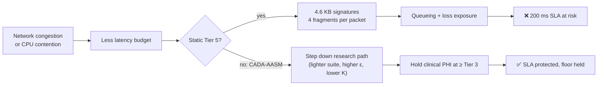

A longer framing, including the research question and the three claimed contributions, is in [`docs/PROBLEM_STATEMENT.md`](docs/PROBLEM_STATEMENT.md).

---

## 3. Key ideas and contributions

| # | Idea | Where in the code |
|---|---|---|
| 1 | **Joint crypto + privacy steering**: one tier selects KEM, DSA, AEAD **and** ε, K, L together | [`core/tiers.py`](agile_hq_pqc/core/tiers.py) |
| 2 | **Latency-budget controller** `L = SLA − RTT − 0.5·CPU` with a 3-band steering matrix | [`core/cada.py`](agile_hq_pqc/core/cada.py) |
| 3 | **Anti-flapping hysteresis**: a change commits only after 3 consecutive agreeing probes | `CadaController.decide` |
| 4 | **Domain policy / clinical floor**: `clinical_tier = max(agile_tier, 3)` | `CadaController.clinical_tier_for` |
| 5 | **Hybrid KEM + dual signatures**: X25519 ‖ ML-KEM combined by HKDF over a transcript-salted concatenation; Ed25519 **and** ML-DSA must both verify | [`crypto/hybrid.py`](agile_hq_pqc/crypto/hybrid.py) |
| 6 | **Batch (epoch) PQ signing**: Ed25519 on every packet, ML-DSA over a hash chain every *N* packets | [`crypto/channel.py`](agile_hq_pqc/crypto/channel.py) |
| 7 | **Make-before-break re-keying**: handshake compute kept off the data path | [`gateway.py`](agile_hq_pqc/gateway.py) |
| 8 | **Tamper-evident audit**: SHA-256 hash chain + HMAC on every entry | [`security/audit.py`](agile_hq_pqc/security/audit.py) |
| 9 | **Honest evaluation**: paired trials, ablations, a sensitivity sweep, a real-link check and two reported negative results | [`evaluation/`](evaluation/), [`testbed/`](testbed/) |

> [!NOTE]
> Runtime-adaptive PQC on its own is **not** novel (see [`docs/RELATED_WORK.md`](docs/RELATED_WORK.md)). The defensible claim is the **joint coupling** of transport crypto and privacy parameters under one latency budget with a raw-PHI floor, plus honest evidence about when it helps.

---

## 4. System at a glance

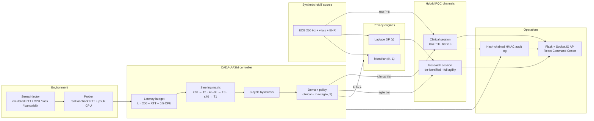

**One control cycle** (`HealthGateway.step`, every 0.5 s in the web app):

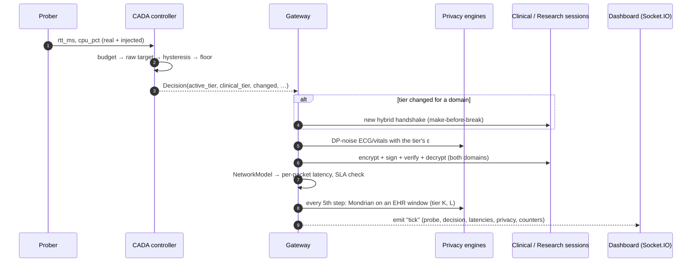

The module-by-module design is in [`docs/ARCHITECTURE.md`](docs/ARCHITECTURE.md).

---

## 5. Security tiers

Tier numbers follow **NIST security categories** (1, 3, 5). Each tier is a joint crypto + privacy bundle.

| Tier | Selected when | KEM | Signature | AEAD | ε (DP) | K | L | KEM pk / ct | Sig size |
|:---:|---|---|---|---|:---:|:---:|:---:|---:|---:|
| 🟢 **T5** Maximum Security | budget **> 80 ms** | ML-KEM-1024 | ML-DSA-87 | AES-256-GCM | **0.1** | 5 | 3 | 1568 / 1568 B | 4627 B |
| 🟡 **T3** Standard Security | **40 – 80 ms** | ML-KEM-768 | ML-DSA-65 | AES-256-GCM | **0.5** | 3 | 2 | 1184 / 1088 B | 3309 B |
| 🔴 **T1** Emergency High Throughput | budget **≤ 40 ms** | ML-KEM-512 | ML-DSA-44 | ChaCha20-Poly1305 | **1.0** | 2 | 2 | 800 / 768 B | 2420 B |

* Smaller **ε** = more DP noise = stronger privacy. Larger **K / L** = bigger, more diverse equivalence classes = stronger anonymity.
* Every tier is **hybrid**: X25519 + ML-KEM for key establishment, Ed25519 + ML-DSA for authentication. Security holds if *either* the classical or the PQ primitive holds.
* **Clinical PHI never goes below T3.** Only the de-identified research stream can drop to T1.

Bytes on the wire for one full hybrid handshake, measured from the real serialised objects:

| Tier | ClientHello (X25519 pk ‖ ML-KEM ek) | ServerHello (X25519 pk ‖ ct ‖ Ed25519 sig ‖ ML-DSA sig) | **Total** |
|:---:|---:|---:|---:|
| T5 | 32 + 1568 = 1600 B | 32 + 1568 + 64 + 4627 = 6291 B | **7891 B** |
| T3 | 32 + 1184 = 1216 B | 32 + 1088 + 64 + 3309 = 4493 B | **5709 B** |
| T1 | 32 + 800 = 832 B | 32 + 768 + 64 + 2420 = 3284 B | **4116 B** |

---

## 6. The CADA-AASM control loop

### 6.1 Latency budget and steering matrix

$$L_{\text{budget}} = \text{SLA} - \text{RTT} - 0.5\cdot\text{CPU}_{\%}, \qquad \text{SLA} = 200\ \text{ms}$$

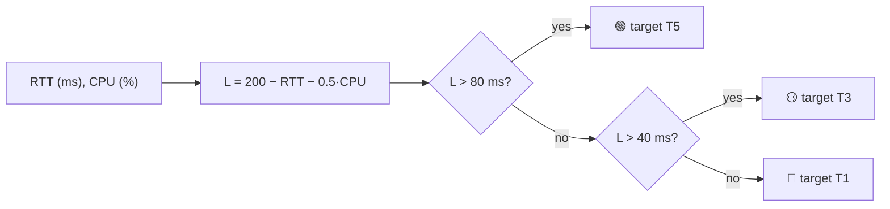

The four built-in stress presets ([`core/probe.py`](agile_hq_pqc/core/probe.py)) are layered on top of the real probes. Jitter is `|N(0, σ)|`, so it only ever adds delay. The budgets below assume a quiet host (≈ 0.2 ms loopback RTT, ≈ 5 % CPU); a busy host lowers them further.

| Preset | Injected RTT | Jitter σ | Injected CPU | Loss | Link | Budget (no jitter → 2σ jitter) | Raw target |
|---|---:|---:|---:|---:|---:|---:|:---:|
| `calm` | 0 ms | 0 | 0 % | 0 % | 100 Mbps | ≈ 197 ms | T5 |
| `moderate` | 85 ms | 5 ms | 30 % | 0.2 % | 20 Mbps | ≈ 97 → 87 ms | T5 |
| `heavy` | 125 ms | 10 ms | 55 % | 0.5 % | 5 Mbps | ≈ 45 → 25 ms (straddles 40) | T3 or T1 |
| `severe` | 150 ms | 15 ms | 75 % | 1 % | 2 Mbps | ≈ 10 → −20 ms | T1 |

### 6.2 Hysteresis (anti-flapping)

A raw target that differs from the active tier must persist for **3 consecutive cycles** before it is committed. An interrupted streak resets the counter. The three "pips" in the dashboard's CADA node show this counter.

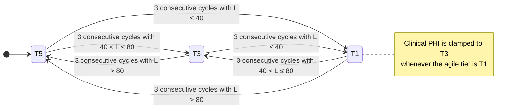

Optional **EWMA smoothing** of the inputs (`smoothing_alpha`: 0.5 in the live UI, 1.0 = off in the evaluation) stops noisy CPU readings that straddle a threshold from resetting the counter forever. A regression test covers exactly that case.

### 6.3 Domain policy: the clinical floor

Two traffic domains run side by side, each with its own session:

| Domain | Payload | Tier rule | Privacy |
|---|---|---|---|
| **Clinical** | Raw PHI (patient id, vitals, raw ECG) | `max(agile_tier, 3)`: never below NIST Cat. 3 | none (authorised clinicians) |
| **Research** | De-identified (subject = `"anon"`, DP-noised vitals + ECG) | full agility T5 / T3 / T1 | ε from the tier; EHR anonymisation uses the tier's (K, L) |

### 6.4 Make-before-break re-keying

When a domain's tier changes, a fresh hybrid handshake for the new suite runs while data still flows on the old session, and the very next packet uses the new keys. Handshake **compute** stays off the data path. Handshake **bytes** (4–8 KB) are charged to the next packet's serialisation time.

---

## 7. Cryptographic layer

### 7.1 Hybrid handshake

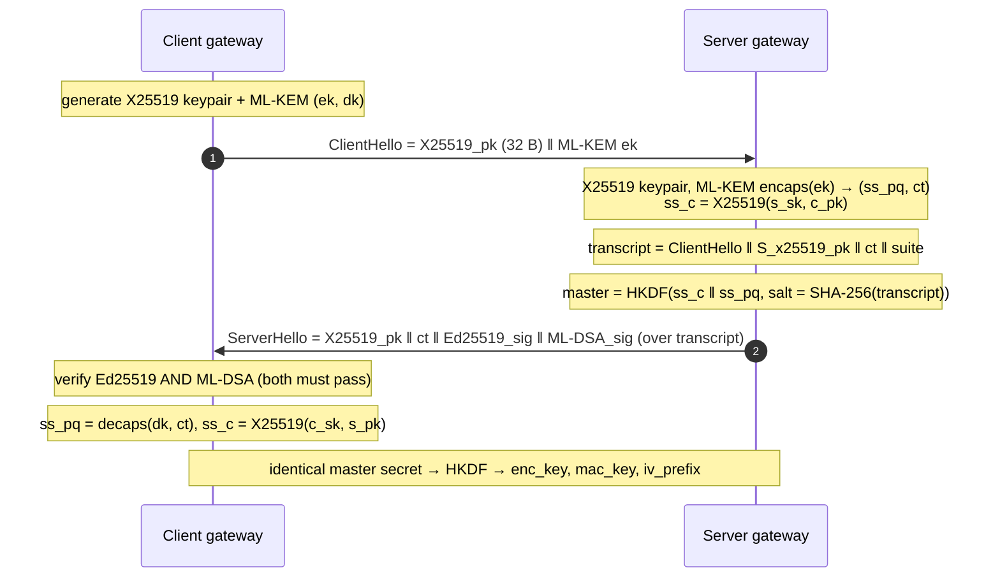

* **Combiner**: HKDF-SHA256 over the **concatenation** of both shared secrets, salted with the transcript hash (the construction used by current hybrid-KEM drafts). The original specification's `XOR → HKDF` is kept as `combine_secrets(..., mode="xor")` for comparison.
* **Dual signature (AND)**: forging a handshake requires breaking *both* Ed25519 and ML-DSA.

### 7.2 Data-path packet

```
┌────── header (17 B: AEAD AAD, and signed) ──────┐
│ tier (1) │ session_id (8) │ seq (8)              │ iv (12) │ len (4) │ ciphertext (n) │ tag (16) │ Ed25519 sig (64) │ sig_len (2) │ ML-DSA epoch sig (0 or 2420–4627) │
└──────────────────────────────────────────────────┘
```

* `iv = iv_prefix (4 B, from HKDF) ‖ seq (8 B)`, so a nonce never repeats within a session.
* AEAD associated data = `header ‖ domain`, which binds every packet to its tier, session, sequence number **and** traffic domain.
* Fixed overhead is **115 B** per packet: a 294 B telemetry payload becomes a 409 B packet. An epoch-closing packet at Tier 5 also carries the ML-DSA-87 signature and is **≈ 5 029 B** (4 fragments).

### 7.3 Batch (epoch) PQ signing

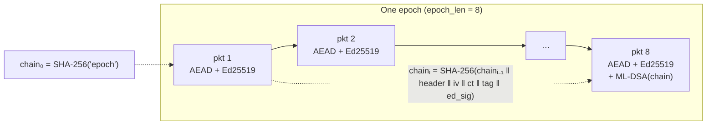

* `epoch_len = 1` puts ML-DSA on **every** packet (the original design, used as the evaluation baseline).
* `epoch_len = 8` (live default) amortises one 2.4–4.6 KB PQ signature over 8 packets. A forged, dropped or reordered packet anywhere in the epoch invalidates the PQ signature.

### 7.4 Receiver checks (in order)

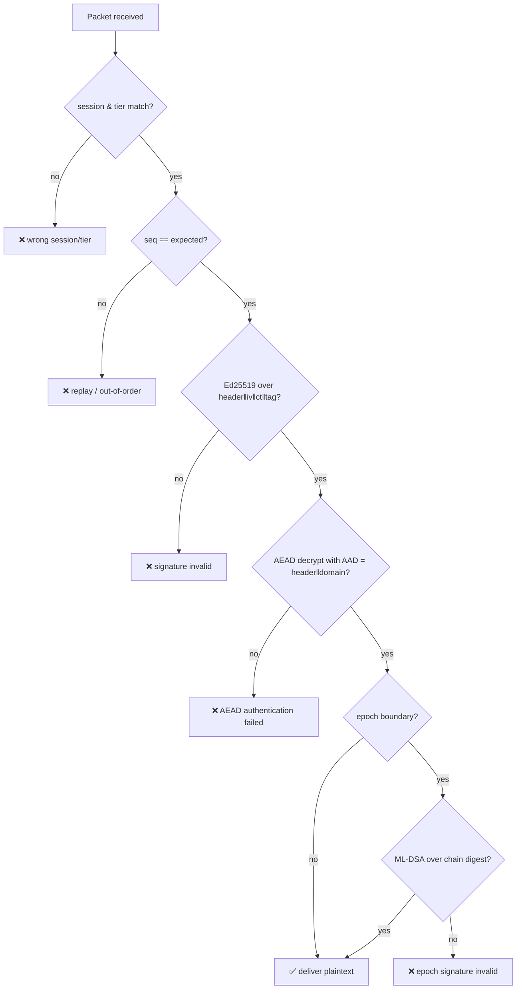

---

## 8. Privacy layer

### 8.1 Differential privacy on continuous streams

* The **Laplace mechanism** is applied to every ECG sample and vital sign: noise scale `b = Δ / ε`, with sensitivity **Δ = 0.5 mV**.
* ε follows the tier (0.1 / 0.5 / 1.0). A `PrivacyAccountant` tracks spend under sequential composition.
* The dashboard plots the privacy/utility curve (ε → ECG SNR in dB) and lets you drag ε live.

### 8.2 (K, L)-anonymity on EHR tables

* **Mondrian** strict multidimensional partitioning (LeFevre et al., 2006), extended with **distinct L-diversity** on the sensitive attribute (diagnosis).
* Quasi-identifiers: `age` (numeric range), `zip` (prefix masking, e.g. `6320**`), `sex` (suppressed to `*` if mixed). The direct identifier `patient_id` is dropped.
* Every release is re-checked by an **independent verifier** (`verify_k_l`). If the whole table cannot satisfy (K, L), it is **suppressed**, never leaked.
* Information loss is reported as the **Normalized Certainty Penalty** (0 = no loss, 1 = fully generalised).

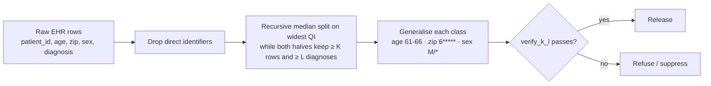

The researcher export enforces a **hard floor of K ≥ 5, L ≥ 3**, whatever the current tier.

---

## 9. Security services: audit and RBAC

### 9.1 Tamper-evident audit log

Every handshake, tier change, stress change, tamper test, login (including failed ones), demo run, ingest and export is appended to a log. Each entry stores `prev` (the previous entry's hash), its own SHA-256 `hash`, and an `HMAC-SHA256` `mac` under `AUDIT_HMAC_KEY`. Editing, deleting or forging any entry without the key breaks verification at that index.

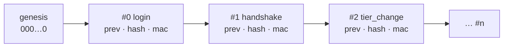

### 9.2 Roles and permissions

Passwords are hashed with PBKDF2-SHA256 (120 000 iterations, random salt). Sessions are HS256 JWTs with an 8 h lifetime. Every REST endpoint **and** the Socket.IO connection check permissions server-side.

| Permission | Admin | Auditor | Researcher | Operator |
|---|:---:|:---:|:---:|:---:|
| `monitor` (Live tab, socket stream) | ✅ | ✅ | ❌ | ✅ |
| `stress` (inject stress, guided demo, **▶ Run demo**) | ✅ | ❌ | ❌ | ❌ |
| `policy` (adaptive ↔ static mode) | ✅ | ❌ | ❌ | ❌ |
| `inspect` (crypto inspector, which shows keys) | ✅ | ❌ | ❌ | ❌ |
| `tamper` (tamper lab) | ✅ | ❌ | ❌ | ❌ |
| `privacy_view` (DP / Mondrian visualiser) | ✅ | ❌ | ✅ | ✅ |
| `privacy_raw` (see raw ECG / EHR) | ✅ | ❌ | ❌ | ✅ |
| `audit_read` (Audit tab) | ✅ | ✅ | ❌ | ❌ |
| `export_deid` (de-identified CSV export) | ✅ | ❌ | ✅ | ❌ |
| `ingest`, `exchange` (operator portal) | ❌ | ❌ | ❌ | ✅ |
| `inspect_meta` (reserved; no endpoint uses it yet) | ❌ | ✅ | ❌ | ❌ |

Tabs per role (Overview and Results are visible to everyone):

| Role | Tabs |
|---|---|
| **Admin** | Overview · Live · Security Lab · Privacy · Data Sharing · Results · Audit |
| **Auditor** | Overview · Live · Results · Audit |
| **Researcher** | Overview · Privacy · Data Sharing · Results |
| **Operator** | Overview · Live · Privacy · Data Sharing · Results |

---

## 10. Web Command Center (dashboard tour)

A React 18 + Recharts single-page app, served by a Flask + Socket.IO backend. It streams one event per control cycle, supports **light / dark / auto** themes, and has a **presenter mode** (press **P**; **Esc** exits) with larger type, higher contrast and secondary panels hidden.

### 10.1 Sign-in

<p align="center">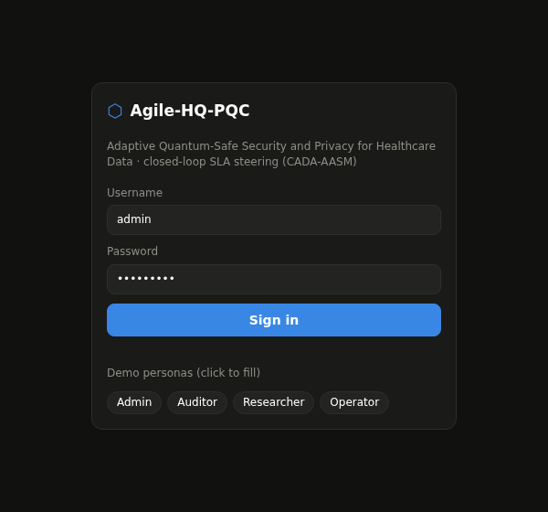</p>

Click a persona chip to fill in demo credentials. On reload, permissions are always re-fetched from the server (`/api/me`), never trusted from the browser.

### 10.2 ▶ Run demo: the hands-free autopilot

<p align="center">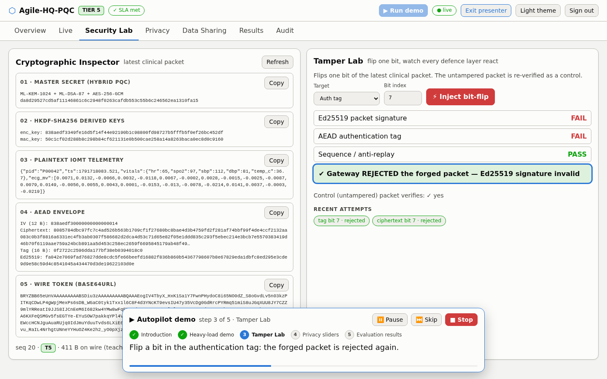</p>

One click, as **admin**, runs the whole presentation **live against the real gateway**. A floating panel narrates each step and offers **Pause / Resume / Skip / Stop**:

| Step | Tab | What happens automatically |
|:---:|---|---|
| 1 | Overview | One-sentence introduction |
| 2 | Live | Starts the guided heavy-load demo. The narration follows each phase as the tier falls 5 → 3 → 1 and recovers, and calls out "Safety floor holding" |
| 3 | Security Lab | Flips one bit in the ciphertext, then the auth tag, then the Ed25519 signature. Each forged packet is **rejected** |
| 4 | Privacy | Sweeps ε from 2 down to 0.1 (more noise on the ECG), then raises K from 2 to 5 |
| 5 | Results | Shows the evaluation charts |

Presenter mode switches on for the tour and is restored afterwards. Clicking any tab hands control back to you. **Stop** also cancels the server-side stress demo, so the gateway is never left congested.

### 10.3 Live: control loop, guided demo, timeline

<table>
<tr>
<td width="50%">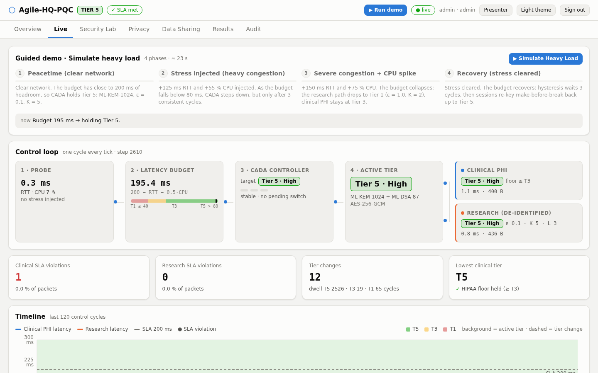<br><sub><b>Peacetime.</b> Budget ≈ 195 ms → Tier 5 on both paths.</sub></td>
<td width="50%">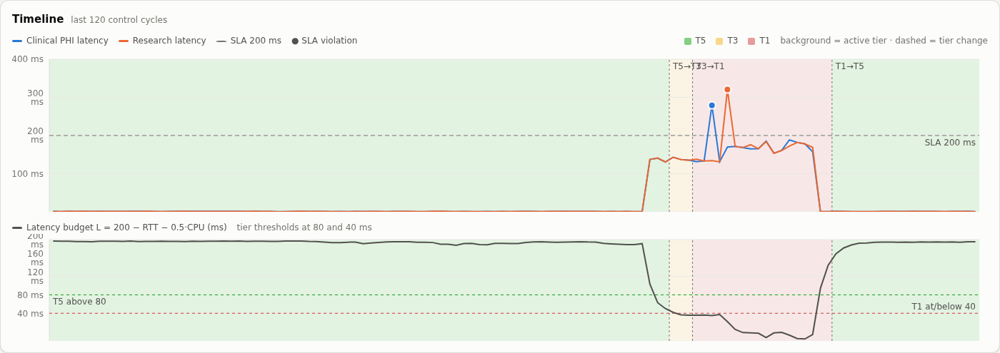<br><sub><b>After the demo.</b> The timeline shows T5 → T3 → T1 → T5, with background bands for the active tier and dashed lines at each change.</sub></td>
</tr>
</table>

| Panel | What it shows |
|---|---|
| **Guided demo** | 4-phase progress rail (Peacetime → Heavy → Severe → Recovery, ≈ 23 s) with narration and a live "*now*" caption generated from the current decision |
| **Control loop** | Probe → Budget (with a T1/T3/T5 band bar) → CADA (target + hysteresis pips) → Active tier → Clinical PHI / Research nodes |
| **KPIs** | Clinical and research SLA violations, tier changes + dwell per tier, lowest clinical tier (floor check) |
| **Timeline** | Latency of both paths against the 200 ms SLA, plus the budget trace with its 80 / 40 ms thresholds, in two synced charts |
| **Tier ladder** | The tier table with the active row highlighted |
| **Manual controls** (admin) | Stress presets `calm / moderate / heavy / severe`; Adaptive ↔ Static Tier 5 baseline |
| **Events** | Tier changes, re-keys, SLA violations and demo phases |

### 10.4 Security Lab: cryptographic inspector and tamper lab

<p align="center">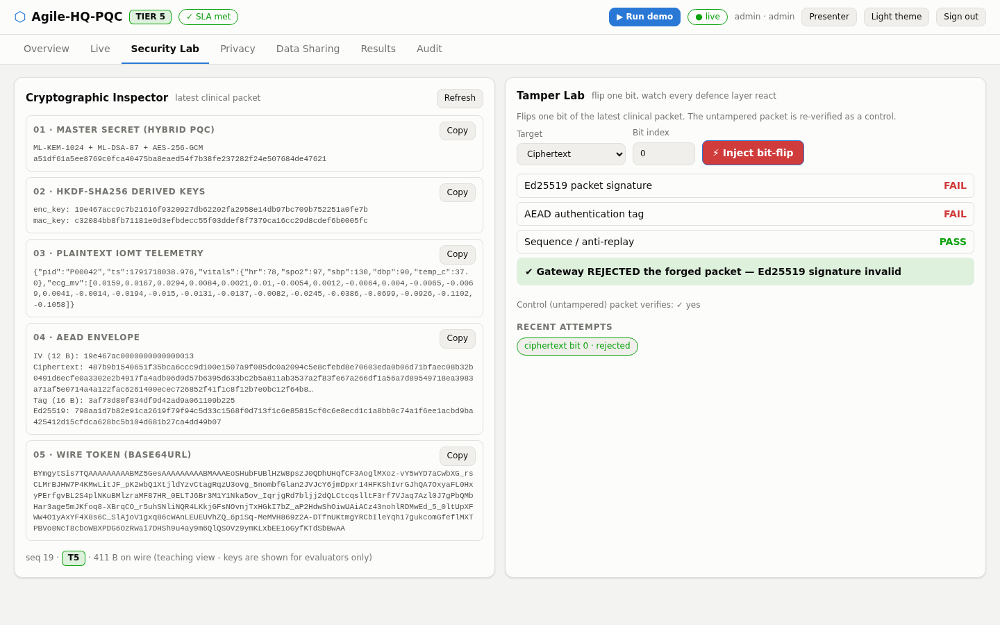</p>

The **inspector** shows five stages of the latest real clinical packet: hybrid master secret → HKDF keys → plaintext telemetry → AEAD envelope (IV, ciphertext, tag, Ed25519 signature) → base64url wire token. Each stage has a copy button.

<table>
<tr>
<td width="50%">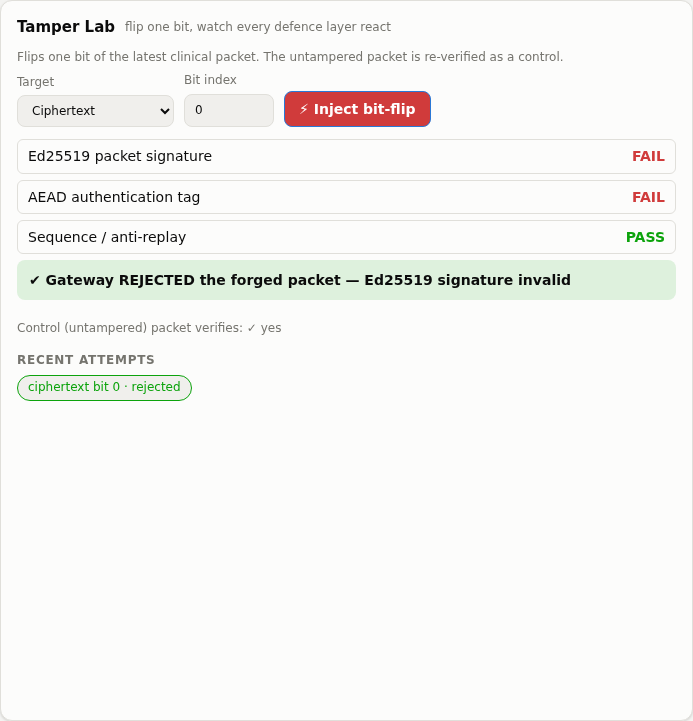</td>
<td>

The **tamper lab** takes the latest clinical packet, flips one chosen **bit** in a chosen **field**, and evaluates each receiver layer independently. These verdicts were measured on the running system:

| Flipped field | Ed25519 | AEAD | Sequence |
|---|:---:|:---:|:---:|
| Ciphertext | ❌ | ❌ | ✅ |
| Auth tag | ❌ | ❌ | ✅ |
| IV / nonce | ❌ | ❌ | ✅ |
| Header (sequence) | ❌ | ❌ | ❌ |
| Ed25519 signature | ❌ | ✅ | ✅ |

An untampered **control** copy is verified alongside, to prove the rejection was caused by the flip.

</td>
</tr>
</table>

### 10.5 Privacy: before vs after

<p align="center">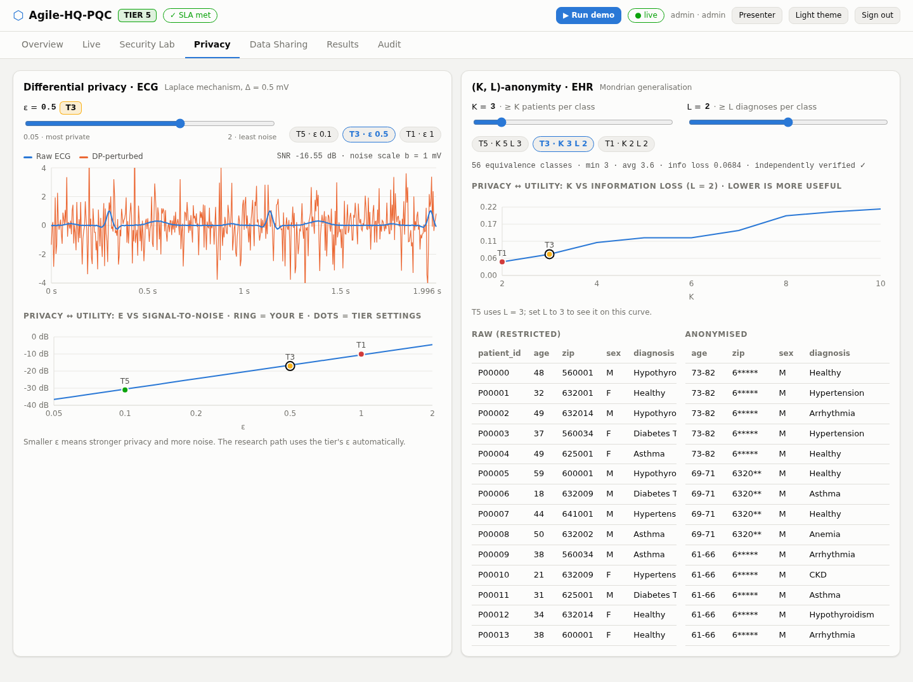</p>

Left: raw vs DP-perturbed ECG with a logarithmic ε slider and the ε → SNR privacy/utility curve; the three tier settings are marked as dots and your current ε as a ring. Right: K and L sliders, raw (restricted) vs anonymised EHR rows, equivalence-class statistics, the K → information-loss curve and an "independently verified ✓" check. Roles without `privacy_raw` see only the protected data.

### 10.6 Data Sharing: researcher and operator portals

<table>
<tr>
<td width="50%">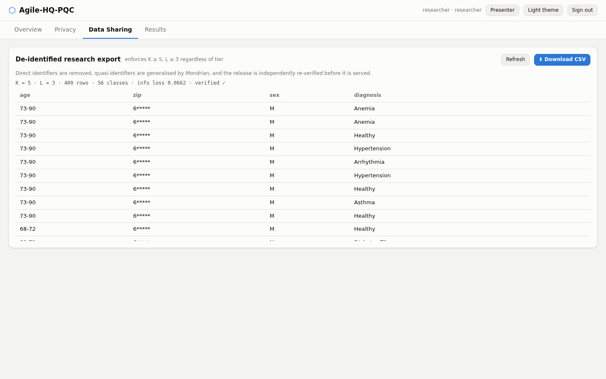<br><sub><b>Researcher.</b> De-identified export, floored at K ≥ 5, L ≥ 3 and verified before it is served, with a CSV download.</sub></td>
<td width="50%">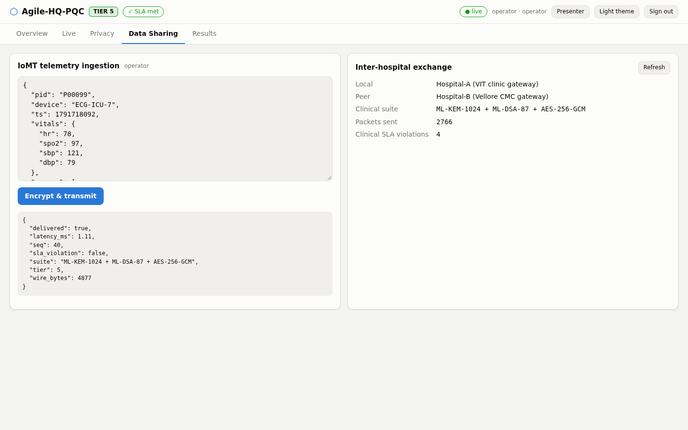<br><sub><b>Operator.</b> Paste an IoMT JSON record (≤ 16 KiB) and it is encrypted and sent over the clinical session; inter-hospital exchange status alongside.</sub></td>
</tr>
</table>

### 10.7 Results: interactive evaluation

<p align="center">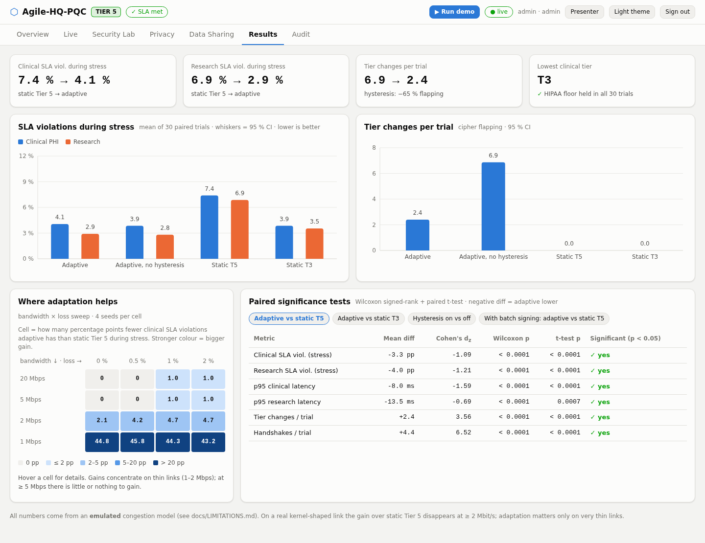</p>

Headline KPIs, SLA-violation and tier-change bar charts with 95 % CIs, the bandwidth × loss heat-map, and the paired significance tests for all four comparisons (including the batch-signing negative result). Everything is read live from [`reports/results.json`](reports/results.json).

### 10.8 Audit: tamper-evident log

<p align="center">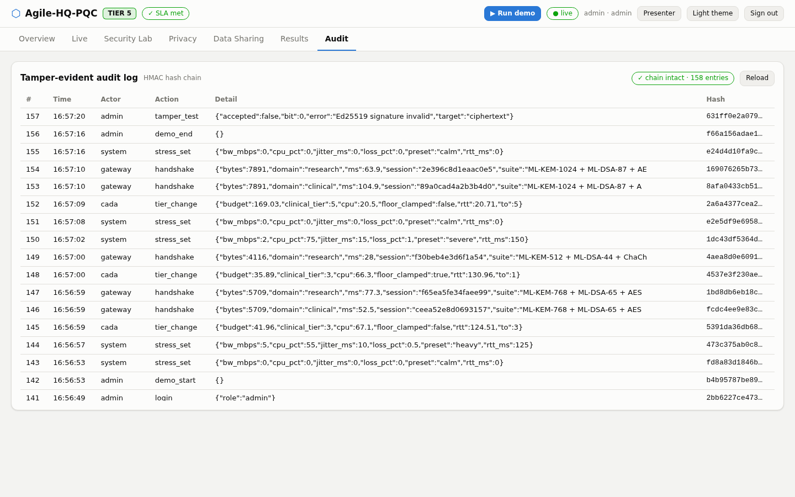</p>

Every event with its actor, action, JSON detail and hash. The badge shows the live chain verification result (`✓ chain intact · N entries`).

---

## 11. Quick start

### 11.1 Prerequisites

| Requirement | Needed for | Notes |
|---|---|---|
| **Python ≥ 3.10** | everything | Tested on 3.10 and 3.13 |
| Node.js ≥ 18 + npm | changing the dashboard only | The production build is already in `agile_hq_pqc/web/static/app/` |
| `pdflatex` + `bibtex` | rebuilding the PDFs only | Pre-built PDFs are in `Compiled_PDFs/` |
| Linux + root, kernel `tbf` qdisc | the real-link testbed only | See [§17](#17-real-link-testbed) |

No special hardware is needed.

### 11.2 Install and run

```bash
cd agile-hq-pqc
python3 -m venv .venv && source .venv/bin/activate      # Windows: .venv\Scripts\activate
pip install --upgrade pip && pip install -r requirements.txt

python run.py                 # Command Center → http://127.0.0.1:5000
python -m pytest -q           # 250 tests (65 core + 185 KAT & security tests), ≈ 30 s
```

Then open <http://127.0.0.1:5000>, sign in as `admin` / `admin@pqc`, and click **▶ Run demo**.

> [!TIP]
> On macOS, port 5000 is often taken by AirPlay Receiver. Use `PORT=5001 python run.py` (PowerShell: `$env:PORT=5001; python run.py`).

### 11.3 Demo logins

| Role | Username | Password | Env override |
|---|---|---|---|
| Admin | `admin` | `admin@pqc` | `ADMIN_PW` |
| Auditor | `auditor` | `audit@pqc` | `AUDITOR_PW` |
| Researcher | `researcher` | `research@pqc` | `RESEARCHER_PW` |
| Hospital operator | `operator` | `operator@pqc` | `OPERATOR_PW` |

### 11.4 Headless demo

```bash
python run.py --demo            # real host probes, ≈ 25 s
python run.py --demo --fast     # no sleeping between cycles (≈ 1 s)
python run.py --demo --static   # same scenario with adaptation OFF (static Tier 5 baseline)
```

Prints one row per cycle (budget, RTT, CPU, hysteresis count, agile tier, PHI tier, clinical/research latency, ε, K/L and events such as tier change, re-key, floor holding or SLA violation), then the counters and the audit-chain verification.

### 11.5 Working on the dashboard

```bash
cd frontend && npm install
npm run dev     # Vite on http://localhost:5173, proxying /api and /socket.io to a running `python run.py`
npm run build   # rebuild agile_hq_pqc/web/static/app/ (served by Flask at /)
```

If the build folder is missing, `/` returns a `503` that tells you to run the build.

### 11.6 Sharing the project as a zip

Package from the project folder and leave out generated, machine-specific and private files:

```bash
zip -r ../agile-hq-pqc.zip . \
  -x '.venv/*' 'frontend/node_modules/*' '*/__pycache__/*' '__pycache__/*' '*.pyc' \
     '.pytest_cache/*' 'data/*' '*.zip'
```

> [!WARNING]
> Do **not** ship `frontend/node_modules/`. It is ≈ 90 MB of platform-specific binaries, and many extractors (Windows Explorer, Python's `zipfile`) drop its execute bits, so `npm run build` then fails with `vite: Permission denied`. The recipient recreates it with `npm install`. Also leave out `data/audit.jsonl`, a runtime log of logins and demo runs. Details: [`docs/SETUP_PROMPT.md`](docs/SETUP_PROMPT.md#packaging-the-project-for-someone-else).

---

## 12. Configuration

### 12.1 Environment variables

| Variable | Default | Purpose |
|---|---|---|
| `HOST` | `127.0.0.1` | Bind address of the web server |
| `PORT` | `5000` | Port of the web server |
| `AUDIT_PATH` | `data/audit.jsonl` | Where the audit log is persisted (JSON lines). Delete the file to reset the log |
| `AUDIT_HMAC_KEY` | dev key | HMAC key for audit entries. **Set this for any real use** |
| `JWT_SECRET` | dev secret | HS256 signing key for session tokens. **Set this for any real use** |
| `ADMIN_PW`, `AUDITOR_PW`, `RESEARCHER_PW`, `OPERATOR_PW` | see [§11.3](#113-demo-logins) | Demo account passwords |

> [!CAUTION]
> The defaults are for local demos only. Anywhere beyond `localhost`, set every secret above and run behind a TLS-terminating reverse proxy. The development server has no TLS.

### 12.2 Tunable constants

| Constant | Location | Value |
|---|---|---|
| `SLA_MS` | `core/tiers.py` | 200 ms |
| `BUDGET_HIGH` / `BUDGET_LOW` | `core/tiers.py` | 80 / 40 ms |
| `HYSTERESIS_CYCLES` | `core/tiers.py` | 3 |
| `MIN_SECURITY_TIER` | `core/tiers.py` | 3 |
| `STRESS_PRESETS` | `core/probe.py` | calm / moderate / heavy / severe (see [§6.1](#61-latency-budget-and-steering-matrix)) |
| `MTU_PAYLOAD`, `ECG_CHUNK` | `gateway.py` | 1 400 B, 25 samples per packet |
| `epoch_len` | `HealthGateway(...)` | 8 (live); 1 or 8 (evaluation) |
| `anon_every` | `HealthGateway(...)` | Mondrian every 5 cycles |
| `step_interval` | `create_app(...)` | 0.5 s per control cycle |
| `LIVE_ALPHA` | `web/app.py` | 0.5 (EWMA smoothing in the UI) |
| `DEMO_PHASES` | `web/app.py` | calm × 8 → heavy × 10 → severe × 12 → calm × 16 |
| `EXPORT_MIN_K`, `EXPORT_MIN_L` | `web/app.py` | 5, 3 |

---

## 13. API reference

All endpoints except `/`, `/healthz` and `/api/login` require `Authorization: Bearer <JWT>`. Errors are JSON `{"error": "…"}` with status `400`, `401`, `403`, `404`, `413` or `422`.

| Method | Path | Permission | Description |
|---|---|---|---|
| `GET` | `/` | – | React Command Center (503 if the frontend is not built) |
| `GET` | `/healthz` | – | Liveness probe → `{"ok": true}` |
| `POST` | `/api/login` | – | `{username, password}` → `{token, role, user, permissions}` |
| `GET` | `/api/me` | any role | Current user and server-side permissions |
| `GET` | `/api/state` | `monitor` | Last 120 events, counters, tiers, presets, demo state, `demo_phases`, `step_interval`, `sla_ms` |
| `POST` | `/api/stress` | `stress` | `{preset}`: apply a stress preset |
| `POST` | `/api/demo/start` | `stress` | Start the 4-phase guided demo → `{started, phases}` (`started: false` if one is already running) |
| `POST` | `/api/demo/stop` | `stress` | Cancel a running guided demo and restore `calm` → `{stopped}` |
| `POST` | `/api/mode` | `policy` | `{adaptive, static_tier}`: switch controller mode (restarts counters) |
| `GET` | `/api/trace` | `inspect` | Five-stage trace of the latest clinical packet |
| `POST` | `/api/tamper` | `tamper` | `{target, bit}` with target ∈ `ciphertext, tag, signature, iv, header` → per-layer verdicts + control |
| `POST` | `/api/ingest` | `ingest` | Send a JSON record (≤ 16 KiB) over the clinical session |
| `GET` | `/api/exchange` | `exchange` | Inter-hospital exchange status |
| `GET` | `/api/privacy/ecg` | `privacy_view` | Raw (only with `privacy_raw`) and DP ECG at ε = 0.1/0.5/1.0; `?eps=` (0.05–2) adds one series at that ε with its SNR and noise scale |
| `GET` | `/api/privacy/tradeoff` | `privacy_view` | `?l=`: ε → SNR curve, K → information-loss curve, tier settings |
| `GET` | `/api/privacy/ehr` | `privacy_view` | `?k=&l=`: Mondrian on synthetic EHR, with verification |
| `GET` | `/api/export/deid` | `export_deid` | De-identified export (`?format=csv`), floored at K ≥ 5, L ≥ 3 |
| `GET` | `/api/results` | any role | Evaluation summary from `reports/results.json` (404 if not generated) |
| `GET` | `/api/audit` | `audit_read` | `?n=`: last entries + chain verification |
| `GET` | `/api/audit/verify` | `audit_read` | Chain verification only |

**Socket.IO**: connect with `auth: {token}`; the token must carry `monitor`. The server emits `tick` (one event per cycle), `demo_phase` (`{label, preset, done?}`) and `server_error`.

---

## 14. Repository layout

```
agile-hq-pqc/
├── agile_hq_pqc/                 Python package
│   ├── core/
│   │   ├── tiers.py              Tier table, SLA, thresholds, clinical floor
│   │   ├── cada.py               Budget formula, steering matrix, hysteresis, floor
│   │   └── probe.py              Real RTT/CPU probes, StressInjector, presets
│   ├── crypto/
│   │   ├── hybrid.py             X25519+ML-KEM, Ed25519+ML-DSA, HKDF combiner, handshake
│   │   └── channel.py            Packet format, AEAD, per-packet Ed25519, epoch ML-DSA
│   ├── privacy/
│   │   ├── dp.py                 Laplace mechanism + privacy accountant
│   │   ├── mondrian.py           Mondrian (K, L) + independent verifier
│   │   └── data.py               Synthetic ECG / vitals / EHR
│   ├── security/
│   │   ├── audit.py              SHA-256 hash chain + HMAC audit log
│   │   └── auth.py               PBKDF2, HS256 JWT, role → permission matrix
│   ├── gateway.py                Orchestration, network-latency model, tamper lab, ingest
│   └── web/
│       ├── app.py                Flask + Socket.IO API, control-loop thread, guided demo
│       └── static/app/           React production build (served at /)
├── frontend/                     React 18 + Vite + Recharts source of the dashboard
│   └── src/
│       ├── App.jsx               Shell, tabs, sign-in, theme, presenter mode
│       ├── useGateway.js         /api/state + Socket.IO stream
│       ├── ui.jsx · styles.css   Shared components and theme tokens
│       ├── autopilot/            ▶ Run demo: script, runner hook, overlay
│       └── components/           live/ (PipelineFlow, DemoStepper, Timeline), Security, Privacy, Sharing, Results, Audit, Overview
├── demo/run_gateway_demo.py      Headless terminal demo
├── evaluation/
│   ├── run_eval.py               30 paired trials + bandwidth × loss sweep + figures
│   └── make_tex_tables.py        LaTeX tables for the paper from results.json
├── testbed/                      Real-link testbed (netns + tbf), analysis, native liboqs bench
├── reports/                      Evaluation + testbed reports, results JSON, fig1–fig5, fig6_testbed
├── tests/                        250 pytest tests (65 core + 185 KAT & tier security tests)
├── docs/                         Architecture, demo script, limitations, problem statement, related work, images/
├── LaTeX_Sources/                paper.tex · patent.tex · references.bib · results_tables.tex · figures/
├── Compiled_PDFs/                Agile_HQ_PQC_Paper.pdf · Agile_HQ_PQC_Patent.pdf
├── run.py                        Launcher (web / --demo)
└── requirements.txt
```

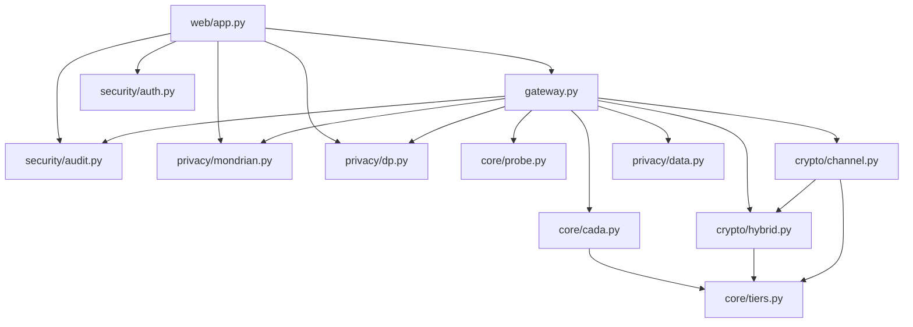

---

## 15. Testing

```bash
python -m pytest -q        # 250 passed, 18 skipped (core suite + NIST KAT & property testing)
```

| Suite | Tests | Covers |
|---|---:|---|
| `test_cada.py` | 11 | Budget formula, thresholds, tier parameters, 3-cycle hysteresis, single-spike immunity, streak reset, clinical floor, recovery, static baseline, EWMA smoothing vs noisy probes, unsmoothed default |
| `test_crypto.py` | 25 | Handshake + FIPS 203/204 sizes, round-trip + epoch signature, bit-flip rejection (4 fields), AAD mismatch + replay, bad epoch signature (each × 3 tiers); combiner depends on both secrets |
| `test_privacy.py` | 7 | DP noise ∝ 1/ε, invalid ε, accountant, Mondrian satisfies (K, L) for every tier, information loss grows with K, no direct identifiers, too-small tables suppressed |
| `test_security.py` | 4 | Audit chain detects tampering, deletion and forgery without the key; persistence; JWT roles |
| `test_gateway.py` | 7 | Peacetime T5 within SLA, downshift after hysteresis + recovery, PHI never < T3, privacy follows tier, tamper lab rejects every target, ingest uses the clinical session, bigger packets fragment more |
| `test_web.py` | 11 | Login / 401, full RBAC matrix, researcher export floor + hidden raw data, socket auth, XSS-safe audit, React-only frontend (`/legacy` → 404), `/api/me`, demo phases in state, privacy slider endpoints, results endpoint, stoppable guided demo |
| `test_tier_standards_kat.py` | 134 | NIST FIPS 203 (ML-KEM) & FIPS 204 (ML-DSA) Known Answer Tests (KAT) from official CAVP projection vectors; AEAD KAT |
| `test_tier_channel_security.py` | 32 | Hypothesis property-based fuzzing of channel key derivation, IV uniqueness, replay window, and packet integrity |
| `test_tier_controller_security.py` | 19 | Hypothesis property testing of CADA controller invariants, NaN safety, compliance floor preservation, and oscillation limits |

---

## 16. Evaluation and results

### 16.1 Method

* **Part A: staged stress, 30 paired trials** (seeds 1–30). Each trial is 60 control cycles:
  `calm × 12 → moderate × 10 → heavy × 10 → severe × 12 → calm × 16`.
* **Part B: sensitivity sweep.** Constant severe RTT/CPU stress, link bandwidth ∈ {20, 5, 2, 1} Mbps × loss ∈ {0, 0.5, 1, 2} %, 4 seeds per cell.
* Host probes are fixed (0.2 ms, 5 %) during evaluation so that parallel workers don't perturb the controller.
* Statistics: mean ± 95 % CI, **Wilcoxon signed-rank** and paired-t p-values, Cohen's **d_z**.

| Configuration | Controller | PQ signing |
|---|---|---|
| `adaptive` | CADA-AASM, 3-cycle hysteresis | every packet |
| `adaptive_nohyst` | CADA, no hysteresis (ablation) | every packet |
| `static_t5` / `static_t3` | fixed tier | every packet |
| `adaptive_batch` | CADA-AASM | every 8 packets |
| `static_t5_batch` | fixed T5 | every 8 packets |

```bash
python evaluation/run_eval.py                       # ≈ 17 min on 2 cores → reports/
python evaluation/run_eval.py --trials 10 --workers 4
python evaluation/make_tex_tables.py                # → LaTeX_Sources/results_tables.tex
```

### 16.2 Headline results

| Metric | CADA-AASM | Static T5 | Static T3 | CADA no-hyst | CADA + batch |
|---|---:|---:|---:|---:|---:|
| Clinical SLA violations in stress | **4.1 %** | 7.4 % | 3.9 % | 3.9 % | 1.1 % |
| Research SLA violations in stress | **2.9 %** | 6.9 % | 3.5 % | 2.8 % | 0.7 % |
| Clinical p95 latency | **187.7 ms** | 195.7 ms | 187.3 ms | 187.4 ms | 173.7 ms |
| Tier changes / trial | **2.4** | 0 | 0 | 6.9 | 2.4 |
| Mean ε (agile path) | 0.37 | 0.10 | 0.50 | 0.40 | 0.37 |
| Mean K (agile path) | 4.07 | 5 | 3 | 3.97 | 4.07 |
| Min clinical tier | **3** | 5 | 3 | 3 | 3 |

> [!NOTE]
> * vs **static Tier 5**: SLA violations under stress fall **7.4 % → 4.1 %** (clinical) and **6.9 % → 2.9 %** (research), p < 1e-4.
> * vs **static Tier 3**: no significant difference in clinical violations. The gain is running the strongest suite and privacy parameters whenever the budget allows (mean ε 0.37 vs 0.50, mean K 4.07 vs 3).
> * **Hysteresis** cuts tier changes **6.9 → 2.4** per trial (−65 %) with no SLA penalty.
> * **Clinical floor** held in every trial (min clinical tier = 3).
> * **Where it helps**: bandwidth-constrained links (≈ −45 percentage points at 1 Mbps); little or nothing at ≥ 5 Mbps.
> * **Negative result**: batch ML-DSA signing on its own removes most of the latency problem. After that, steering is latency-neutral, and its remaining value is joint privacy/crypto adaptation.

### 16.3 Figures

<p align="center"></p>

**Figure 1: Research-path latency under staged stress (median + IQR across 30 trials).** Both configurations track the injected RTT through *moderate* and *heavy*. In the *severe* phase, static T5 rides close to the 200 ms SLA, while CADA-AASM has stepped down to T1 and stays ≈ 10–15 ms lower.

<p align="center"></p>

**Figure 2: SLA violations during stress (mean ± 95 % CI).** Static T5 is worst on both paths. CADA matches static T3 while running stronger parameters most of the time. Batch signing (T5 batch, CADA batch) dominates everything.

<p align="center"></p>

**Figure 3: Tier trajectory (seed 1) and flapping.** Without hysteresis the controller bounces T5 → T3 → T1 → T3 → T1. With the 3-cycle filter it makes one clean step down and one step up. Right: tier changes per trial drop from a median of 7 to 2.

<p align="center"></p>

**Figure 4: Tier dwell on the agile path.** CADA-AASM spends ≈ 68 % of cycles at Tier 5, ≈ 3 % at T3 and ≈ 29 % at T1, so it gives full-strength protection whenever the network allows.

<p align="center"></p>

**Figure 5: Where adaptive steering helps (CADA − static T5, percentage points of SLA violations).** Near zero at 20 and 5 Mbps; −2 to −5 pp at 2 Mbps; **≈ −45 pp at 1 Mbps**, where static T5 violates the SLA on ≈ 70 % of packets.

Full tables and paired tests: [`reports/module7_evaluation_report.md`](reports/module7_evaluation_report.md).

---

## 17. Real-link testbed

The main evaluation emulates congestion. To check whether its conclusions survive real traffic, `testbed/` builds a **real shaped link** on one Linux host:

* two network namespaces joined by a veth pair, with kernel **tbf** bandwidth shaping in both directions;
* real TCP carrying the project's **real packet bytes** (AEAD + Ed25519 + ML-DSA epochs, FIPS 203/204 sizes);
* RTT measured by an echo probe over the shaped link, and CPU read from the host under real busy-loop load.

Still emulated or omitted: propagation delay (a stated receiver hold), random packet loss (kernel `netem` was unavailable), and PQ compute (native liboqs cost was measured separately at ≈ 0.1 ms).

```bash
pip install -r testbed/requirements.txt                 # pyroute2
sudo -E env "PATH=$PATH" python testbed/run_testbed.py --quick              # smoke run
sudo -E env "PATH=$PATH" python testbed/run_testbed.py --reps 4 --sweep-reps 4   # ≈ 35 min on 2 cores
python testbed/analyze.py                               # → reports/testbed_report.md, fig6_testbed.png
```

<p align="center">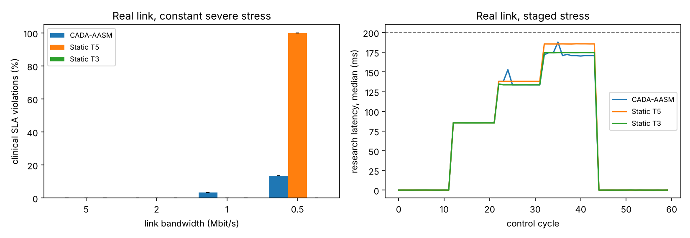</p>

> [!WARNING]
> **Honest outcome.** On the real link, **no configuration violated the SLA at ≥ 2 Mbit/s**, so the emulated gain over static Tier 5 is **not reproduced** there. The emulator's fragment-queueing and loss terms drove those violations, not the wire bytes alone. Adaptation matters only on very thin links: at **0.5 Mbit/s** static T5 failed **every** cycle, CADA **13 %**, and a well-chosen **static T3 0 %**. At 1 Mbit/s CADA was slightly *worse* than both static configurations (the transition cost). With n = 4 pairs, no difference can reach p < 0.05; these are descriptive results. Full details: [`reports/testbed_report.md`](reports/testbed_report.md).

`testbed/bench_native_oqs.py` measures native liboqs timings (`reports/native_pqc_bench.json`) and needs liboqs built from source. Native ML-DSA signing is ≈ 0.1 ms, about three orders of magnitude faster than the pure-Python code, which supports excluding PQ compute from per-packet latency.

---

## 18. Deliverables map

| # | Planned deliverable | Status | Where |
|---|---|:---:|---|
| 1 | Web Command Center: live control-loop diagram, annotated tier/SLA timeline, tier ladder, light/dark themes, presenter mode | ✅ | `agile_hq_pqc/web/`, `frontend/`, *Live* tab |
| 2 | One-click **Simulate Heavy Load** guided demo, the hands-free **▶ Run demo** autopilot, and a scripted version | ✅ | *Live* tab · header button · `demo/run_gateway_demo.py` |
| 3 | Cryptographic Inspector (5 packet stages) & Tamper Lab (per-layer verdicts + control) | ✅ | *Security Lab* tab |
| 4 | Before-vs-after privacy visualiser (ECG + Laplace DP; EHR + Mondrian K/L; privacy/utility curves) | ✅ | *Privacy* tab |
| 5 | RBAC portals with JWT: Admin · Auditor · Researcher · Hospital Operator | ✅ | `security/auth.py`, per-role tabs |
| 6 | Research & IP repository: paper, patent draft, evaluation and testbed reports + figures, *Results* tab | ✅ | `LaTeX_Sources/`, `Compiled_PDFs/`, `reports/` |

---

## 19. Research and IP artefacts

| Artefact | Source | Compiled |
|---|---|---|
| IEEE-style paper | [`LaTeX_Sources/paper.tex`](LaTeX_Sources/paper.tex) | [`Compiled_PDFs/Agile_HQ_PQC_Paper.pdf`](Compiled_PDFs/Agile_HQ_PQC_Paper.pdf) |
| Patent specification (draft) | [`LaTeX_Sources/patent.tex`](LaTeX_Sources/patent.tex) | [`Compiled_PDFs/Agile_HQ_PQC_Patent.pdf`](Compiled_PDFs/Agile_HQ_PQC_Patent.pdf) |
| Bibliography | [`LaTeX_Sources/references.bib`](LaTeX_Sources/references.bib) | – |
| Result tables for LaTeX | `evaluation/make_tex_tables.py` → [`LaTeX_Sources/results_tables.tex`](LaTeX_Sources/results_tables.tex) | – |

To rebuild the PDFs:

```bash
cd LaTeX_Sources
pdflatex paper && bibtex paper && pdflatex paper && pdflatex paper
pdflatex patent
```

> [!WARNING]
> The paper and patent are **drafts**. The related-work comparison rests on 18 IEEE Xplore papers read in full by one reviewer (see [`docs/LITERATURE_REVIEW.md`](docs/LITERATURE_REVIEW.md)); it is not a systematic review. The PDFs in `Compiled_PDFs/` must be rebuilt from the current `.tex` sources. Both need a systematic literature search and review by a registered patent agent before submission or filing.

---

## 20. Limitations (read before presenting)

[`docs/LIMITATIONS.md`](docs/LIMITATIONS.md) lists every deviation from the original description. In short:

| Area | Real | Emulated / caveat |
|---|---|---|
| Cryptography | All handshakes, AEAD, Ed25519, ML-KEM, ML-DSA; FIPS 203/204 sizes asserted in tests | PQ libraries are **pure-Python reference code** (`kyber-py`, `dilithium-py`): slow and **not constant-time** |
| Network | Loopback RTT and host CPU probes; a real shaped link in `testbed/` | **Congestion is emulated** in the main evaluation (`StressInjector` + `NetworkModel`), and the real link does **not** reproduce the gain at ≥ 2 Mbit/s |
| Latency model | AEAD + Ed25519 compute (× CPU contention) | ML-DSA and handshake **compute** are not charged (they would measure Python); only their **bytes** are |
| Data | – | **All patient data is synthetic** (sum-of-Gaussians ECG, random EHR) |
| Privacy | Laplace DP, Mondrian k-anonymity + distinct l-diversity | No t-closeness; per-sample ε composes across a waveform window; research-path privacy varies with the tier (exports are floored) |
| Deployment | JWT, PBKDF2, HMAC audit, server-side RBAC | Demo secrets, no TLS, no token revocation; the inspector shows keys (admin only, a teaching feature) |

---

## 21. Future work

* Extend the testbed with kernel `netem` (delay + random loss) or a multi-host VM setup, using the native liboqs stack, to remove the remaining emulated parts.
* Swap pure-Python PQ for **liboqs** (`oqs-python`). The boundary is the two dictionaries `KEM` / `DSA` in `crypto/hybrid.py`.
* Charge native PQ compute to the latency model once a constant-time implementation is in place.
* Stronger privacy models: t-closeness, DP synthetic data, Rényi-DP accounting.
* Predictive steering: forecast the budget instead of reacting to it, to cut the transition cost seen on thin links.
* A systematic literature review (IEEE Xplore, ACM DL, Scopus) and a patent prior-art search.

---

## 22. Further documentation

| Document | Contents |
|---|---|
| [`docs/ARCHITECTURE.md`](docs/ARCHITECTURE.md) | Module-by-module design, data flows, packet format, latency model, threading, frontend architecture, security properties and where they are tested |
| [`docs/DEMO_SCRIPT.md`](docs/DEMO_SCRIPT.md) | Minute-by-minute live demonstration script, with talking points and expected panel questions |
| [`docs/LIMITATIONS.md`](docs/LIMITATIONS.md) | Deviations, real vs emulated, cryptographic / privacy / evaluation caveats |
| [`docs/PROBLEM_STATEMENT.md`](docs/PROBLEM_STATEMENT.md) | Problem, research gap, research question, contributions |
| [`docs/RELATED_WORK.md`](docs/RELATED_WORK.md) | Positioning against prior work (report sections 5.2 and 5.3) |
| [`docs/LITERATURE_REVIEW.md`](docs/LITERATURE_REVIEW.md) | Survey method, what each paper does, positioning and research gap (report section 5) |
| [`docs/REFERENCES.md`](docs/REFERENCES.md) | The 32 references of the report |
| [`docs/SETUP_PROMPT.md`](docs/SETUP_PROMPT.md) | Step-by-step setup and verification checklist (usable by a person or a coding agent) |
| [`reports/module7_evaluation_report.md`](reports/module7_evaluation_report.md) | Full evaluation tables, paired tests and sweep (generated) |
| [`reports/testbed_report.md`](reports/testbed_report.md) | Real-link testbed results and their reading (generated) |

<div align="center"><sub>Agile-HQ-PQC · M.Tech CSE (Cybersecurity) · SCORE, VIT Vellore</sub></div>
