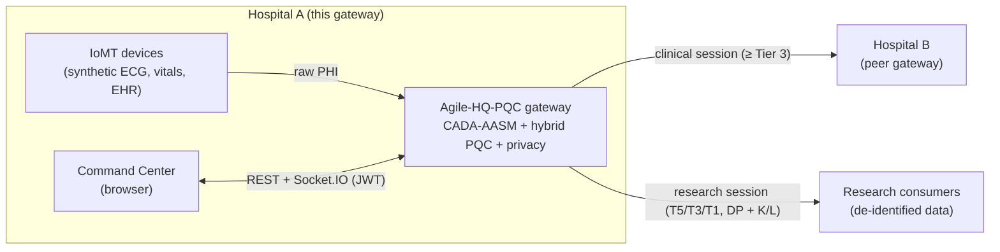
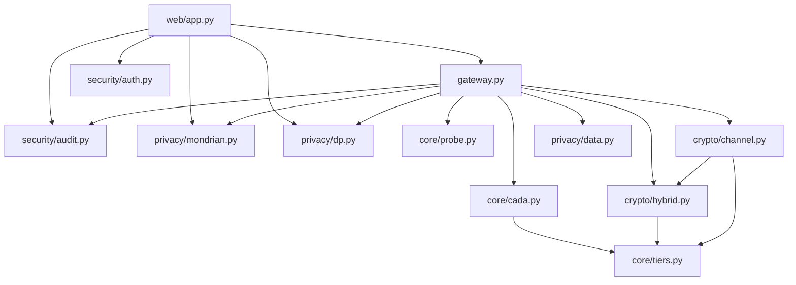
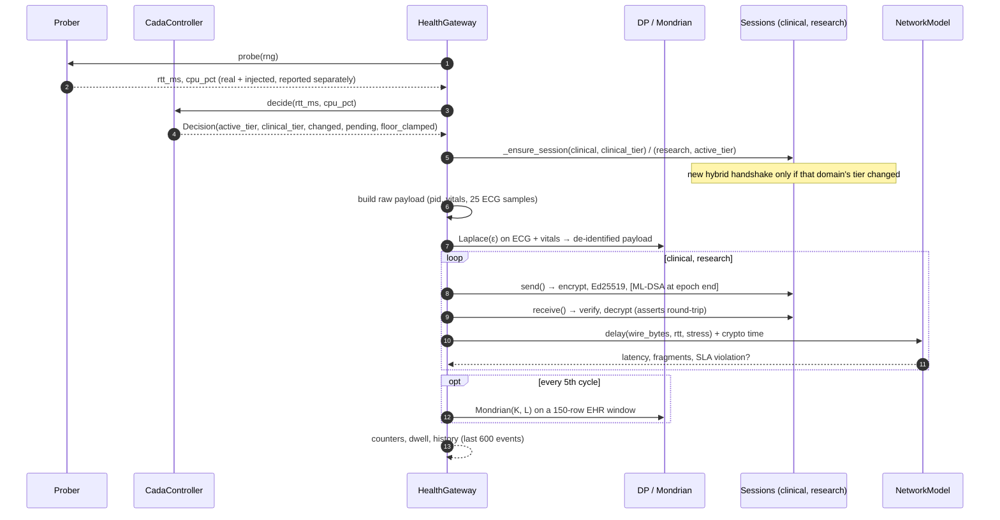
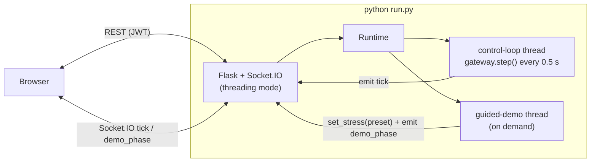

# Architecture

> **Agile-HQ-PQC** · design reference for developers and examiners.
> Start with the [README](../README.md) for the overview; this document explains *how* each part works and *why* it was built that way.

## Contents

1. [Design goals](#1-design-goals)
2. [System context](#2-system-context)
3. [Module map](#3-module-map)
4. [The control cycle](#4-the-control-cycle)
5. [CADA-AASM controller](#5-cada-aasm-controller)
6. [Hybrid handshake](#6-hybrid-handshake)
7. [Data-path packet and receiver](#7-data-path-packet-and-receiver)
8. [Re-keying (make-before-break)](#8-re-keying-make-before-break)
9. [Latency model](#9-latency-model)
10. [Privacy engines](#10-privacy-engines)
11. [Audit log and access control](#11-audit-log-and-access-control)
12. [Web backend: runtime, threading and API](#12-web-backend-runtime-threading-and-api)
13. [Frontend architecture](#13-frontend-architecture)
14. [Security properties and where they are tested](#14-security-properties-and-where-they-are-tested)
15. [Extension points](#15-extension-points)

---

## 1. Design goals

| # | Goal | Consequence in the design |
|---|---|---|
| G1 | Keep raw clinical telemetry inside a 200 ms end-to-end SLA | A latency **budget** drives every security decision |
| G2 | Never drop raw PHI below NIST Category 3 | A domain-policy layer: `clinical_tier = max(agile_tier, 3)` |
| G3 | Steer crypto **and** privacy together | One tier object carries KEM, DSA, AEAD, ε, K and L |
| G4 | No "cipher flapping" | 3-cycle persistence filter; optional EWMA smoothing of inputs |
| G5 | No packet loss on a tier change | Make-before-break re-keying |
| G6 | Be honest about what is measured | Real crypto/privacy; emulated congestion always reported separately; a real-link testbed as a cross-check |
| G7 | Demonstrable to a non-specialist panel | A live web Command Center, a guided demo and a hands-free autopilot |

---

## 2. System context



In the prototype both ends of each session run in one process: the gateway encrypts, signs, transmits through a **latency model**, then verifies and decrypts, so every packet is checked end to end. `testbed/` replaces the latency model with a real shaped TCP link between two network namespaces.

---

## 3. Module map

| Path | Responsibility | Key symbols |
|---|---|---|
| `core/tiers.py` | Tier table (suite, ε, K, L, FIPS sizes), SLA, thresholds, floor | `TIERS`, `SLA_MS`, `BUDGET_HIGH/LOW`, `HYSTERESIS_CYCLES`, `MIN_SECURITY_TIER` |
| `core/cada.py` | Budget formula, steering matrix, hysteresis, floor | `latency_budget`, `target_tier_for_budget`, `CadaController`, `Decision` |
| `core/probe.py` | Real loopback RTT + host CPU; emulated stress | `Prober`, `EchoServer`, `StressInjector`, `STRESS_PRESETS` |
| `crypto/hybrid.py` | X25519 + ML-KEM hybrid KEM, Ed25519 + ML-DSA dual signatures, HKDF combiner, handshake | `KEM`, `DSA`, `Identity`, `combine_secrets`, `hybrid_handshake` |
| `crypto/channel.py` | Packet format, AEAD, per-packet Ed25519, per-epoch ML-DSA | `Packet`, `SecureSender`, `SecureReceiver`, `ReceiveError` |
| `privacy/dp.py` | Laplace mechanism and budget accountant | `laplace_mechanism`, `PrivacyAccountant` |
| `privacy/mondrian.py` | Mondrian (K, L)-anonymisation and independent verifier | `mondrian_anonymize`, `verify_k_l` |
| `privacy/data.py` | Synthetic ECG / vitals / EHR (no real patient data) | `synthetic_ecg`, `vitals_sample`, `synthetic_ehr` |
| `security/audit.py` | SHA-256 hash chain + HMAC audit log | `AuditLog.append/verify/tail` |
| `security/auth.py` | PBKDF2 passwords, HS256 JWT, role → permission matrix | `authenticate`, `decode`, `require`, `PERMISSIONS` |
| `gateway.py` | Orchestration, latency model, tamper lab, ingest | `HealthGateway.step/tamper/ingest`, `NetworkModel` |
| `web/app.py` | Flask + Socket.IO API, control-loop thread, guided demo | `create_app`, `Runtime`, `DEMO_PHASES` |
| `frontend/` | React 18 + Vite + Recharts Command Center (built into `web/static/app/`) | see [§13](#13-frontend-architecture) |



---

## 4. The control cycle

`HealthGateway.step()` runs once per cycle (0.5 s in the web app, as fast as possible in the evaluation) and returns one event dictionary, which the web layer broadcasts as a Socket.IO `tick`.



The event contains: `probe` (real and injected parts), `decision`, `budget_ms`, `active_tier`, `clinical_tier`, `tier_info`, per-domain results (`wire_bytes`, `fragments`, `latency_ms`, `sla_violation`, `crypto_ms`, micro-timings), `rekey`, `handshake` (timings and bytes when a re-key happened), `privacy` (ε, K, L, SNR, last Mondrian result, ε spent), `stress`, `counters` and `dwell`.

---

## 5. CADA-AASM controller

### 5.1 Steering

```
L = 200 − RTT − 0.5 · CPU%          (core/cada.py: latency_budget)
L > 80 ms  → Tier 5
40 < L ≤ 80 → Tier 3                (core/cada.py: target_tier_for_budget)
L ≤ 40 ms  → Tier 1
```

The 0.5 weight on CPU expresses that a fully loaded host (100 %) costs about 50 ms of budget through slower crypto and scheduling.

### 5.2 Hysteresis

`CadaController.decide()` keeps a `(pending_tier, count)` pair:

* raw target == active tier → reset `pending` and `count`;
* raw target == pending → `count += 1`;
* otherwise → `pending = raw target`, `count = 1`;
* `count ≥ 3` → commit (`active_tier = raw`, `changed = True`) and reset.

A single spike can never cause a re-key, and an interrupted streak starts again from 1.

### 5.3 Input smoothing

With `smoothing_alpha < 1`, RTT and CPU pass through an EWMA before the budget is computed. Without it, a host whose CPU reading oscillates across the 40 ms threshold can keep resetting the streak and never settle. `test_noisy_probes_straddling_threshold_stall_without_smoothing_but_not_with` reproduces this. The live UI uses α = 0.5; the evaluation uses 1.0 (off) to match the specification exactly.

### 5.4 Domain policy

`clinical_tier_for(t) = max(t, MIN_SECURITY_TIER)`. `Decision.floor_clamped` is true whenever the clinical tier is held above the agile tier; the dashboard shows this as **🛡 Safety floor holding**.

---

## 6. Hybrid handshake

```
C → S  ClientHello : X25519_pk (32) ‖ ML-KEM_ek
S → C  ServerHello : X25519_pk (32) ‖ ML-KEM_ct ‖ Ed25519_sig (64) ‖ ML-DSA_sig
       signed transcript = ClientHello ‖ S_x25519_pk ‖ ML-KEM_ct ‖ suite-string
master = HKDF-SHA256( ss_x25519 ‖ ss_mlkem , salt = SHA-256(transcript) )
keys   = HKDF( master , "agile-hq-pqc traffic keys " ‖ AEAD-name ) → enc_key (32 B), mac_key (32 B), iv_prefix (4 B)
```

* **Both signatures must verify (AND).** Forging the server's identity requires breaking Ed25519 *and* ML-DSA.
* **Combiner.** The default is HKDF over the *concatenation* of both secrets with a transcript-hash salt, the construction used by current hybrid-KEM drafts. The original specification's `XOR → HKDF` is available as `combine_secrets(..., mode="xor")`. It is not the default, because XOR needs equal-length inputs and adds no transcript binding. `test_combiner_depends_on_both_secrets` checks that changing either secret changes the master.
* **Measured sizes** (total bytes on the wire): T5 7 891 B, T3 5 709 B, T1 4 116 B. The server identity (public keys) is distributed out of band and is not counted.

---

## 7. Data-path packet and receiver

### 7.1 Format

```
header(17) = tier(1) ‖ session_id(8) ‖ seq(8)          ← AEAD AAD and signed
iv(12)     = iv_prefix(4) ‖ seq(8)                     ← never repeats within a session
AEAD       = Enc(enc_key, iv, plaintext, AAD = header ‖ domain) → ct ‖ tag(16)
Ed25519    = Sign(header ‖ iv ‖ ct ‖ tag)              ← every packet (64 B)
chain_i    = SHA-256(chain_{i-1} ‖ header ‖ iv ‖ ct ‖ tag ‖ ed_sig)
ML-DSA     = Sign(chain_i)                             ← when seq % epoch_len == 0
wire       = header ‖ iv ‖ len(4) ‖ ct ‖ tag ‖ ed_sig ‖ sig_len(2) ‖ epoch_sig
```

Fixed overhead: 17 + 12 + 4 + 16 + 64 + 2 = **115 B**. Clinical telemetry (≈ 294 B payload) → ≈ 409 B; with an ML-DSA-87 epoch signature → ≈ 5 029 B (4 fragments at 1 400 B).

AEAD is **AES-256-GCM** at T5/T3 and **ChaCha20-Poly1305** at T1 (faster without AES hardware, which matters on constrained devices).

### 7.2 Receiver order

1. Session id and tier must match the receiver's session.
2. `seq` must equal the expected next sequence number (anti-replay and ordering).
3. Ed25519 over `header ‖ iv ‖ ct ‖ tag`.
4. AEAD decrypt with AAD = `header ‖ domain`. This binds the packet to its traffic domain: a clinical packet replayed into the research session fails.
5. At epoch boundaries: ML-DSA over the running chain digest. A forged, dropped or reordered packet anywhere in the epoch invalidates it.

`SecureReceiver.check_layers()` evaluates Ed25519, AEAD and sequence **independently** (without short-circuiting). The Tamper Lab uses it to show which defences a flipped bit trips.

### 7.3 Epoch length

| `epoch_len` | Meaning | Used by |
|---|---|---|
| 1 | ML-DSA on every packet (the original design) | evaluation baseline |
| 8 | one PQ signature per 8 packets (batch signing) | live gateway default; `*_batch` evaluation configurations |

---

## 8. Re-keying (make-before-break)

When CADA changes a domain's tier, `_ensure_session` runs a fresh hybrid handshake for the new suite **on the control path** while the old session remains usable. The very next packet uses the new session. Consequences:

* No packet is dropped or delayed waiting for a handshake.
* Handshake **compute** (pure-Python ML-DSA signing takes tens of milliseconds) is **not** charged to packet latency.
* Handshake **bytes** (4–8 KB) **are** charged: they are added to the next packet's serialisation time (`extra_bytes` in `NetworkModel.delay`).
* Every handshake is written to the audit log with tier, suite, duration, bytes and session id.

---

## 9. Latency model

```
latency = RTT
        + serialisation       = (wire_bytes + pending_handshake_bytes) · 8 / bandwidth
        + fragment queueing   = (fragments − 1) · (0.05 + 0.8 · injected_RTT / 100) ms
        + loss recovery       = one RTO (RTT + 10 ms + 1 MTU serialisation) with probability 1 − (1 − p)^fragments
        + crypto              = (encrypt + Ed25519 sign + Ed25519 verify + decrypt) × CPU-contention slowdown
fragments = ⌈wire_bytes / 1400⌉,   bandwidth = injected link or 100 Mbps,   slowdown = 1 / max(0.1, 1 − 0.9·CPU_injected)
```

| Term | Real or emulated |
|---|---|
| RTT | real loopback probe **+** injected RTT and `|N(0, σ)|` jitter |
| Bandwidth, loss | emulated (stress preset) |
| Fragment count, wire bytes | real (actual serialised packet) |
| AEAD / Ed25519 time | real, measured per packet, scaled by emulated CPU contention |
| ML-DSA / handshake time | measured and **reported** (`pq_sign_async_ms`) but **not charged** |

This is a *model*, not a network. Its parameters live in `gateway.NetworkModel` and `core/probe.py::STRESS_PRESETS`. The real-link testbed shows that its fragment-queueing and loss terms are what produce the emulated benefit at ≥ 2 Mbit/s (see [`reports/testbed_report.md`](../reports/testbed_report.md)).

---

## 10. Privacy engines

### 10.1 Laplace DP

`laplace_mechanism(signal, ε, sensitivity = 0.5)` clips (optionally), then adds `Laplace(0, Δ/ε)` noise to every sample, and reports the noise scale, SNR (dB) and RMSE. The research payload replaces the patient id with `"anon"`, noises every ECG sample and every vital sign, and records the ε used. `PrivacyAccountant` sums ε under sequential composition.

### 10.2 Mondrian (K, L)

* Strict top-down partitioning (LeFevre et al., 2006). The widest quasi-identifier is split at its median while both halves keep ≥ K rows **and** ≥ L distinct diagnoses.
* Generalisation: numeric range for `age`, common-prefix masking for `zip`, value or `*` for `sex`. `patient_id` is dropped.
* If the whole table cannot satisfy (K, L), the result is **suppressed** rather than released.
* `verify_k_l` independently re-checks every release; the web export refuses to serve (HTTP 422) if verification fails.
* Information loss: Normalized Certainty Penalty, averaged over quasi-identifiers and weighted by class size.

The gateway re-anonymises a 150-row EHR window every 5 cycles with the active tier's (K, L). The researcher export uses `max(tier K, 5)` and `max(tier L, 3)`.

---

## 11. Audit log and access control

### 11.1 Audit chain

Each entry: `idx, ts, actor, action, detail, prev, hash, mac`, where

```
hash = SHA-256( prev ‖ canonical-JSON(idx, ts, actor, action, detail, prev) )
mac  = HMAC-SHA256( AUDIT_HMAC_KEY, canonical-JSON(entry without mac) )
```

`verify()` walks the chain and reports the first broken index and the reason (prev-hash mismatch, hash mismatch, MAC mismatch). The log persists as JSON lines at `AUDIT_PATH` (default `data/audit.jsonl`). Failed logins store the attempted username as **data**; the UI escapes it (tested with a `<script>` payload).

### 11.2 Authentication and authorisation

* Passwords: PBKDF2-HMAC-SHA256, 120 000 iterations, 16-byte random salt.
* Tokens: HS256 JWT, claims `sub`, `role`, `iat`, `exp` (8 h).
* `@auth.require(permission)` guards every REST route. `require(None)` means "any valid token", and is used by `/api/me` and `/api/results`.
* The Socket.IO `connect` handler decodes the token and only joins clients with `monitor` to the broadcast room.
* The frontend hides tabs by permission for usability only. **The server is the enforcement point**, and `/api/me` re-reads permissions on every page load.

---

## 12. Web backend: runtime, threading and API



* **Runtime** owns the gateway, the control-loop thread and the guided demo. `gateway.step()`, `tamper()`, `ingest()` and `set_stress()` all take the gateway's re-entrant lock, so REST calls never observe a half-finished cycle.
* **Guided demo**: `DEMO_PHASES` = calm × 8 → heavy × 10 → severe × 12 → calm × 16 cycles (≈ 23 s). The demo thread waits on a `threading.Event`, so `POST /api/demo/stop` cancels it immediately. Its `finally` block always restores `calm`, and `start_demo` marks the demo active *before* the thread starts so that a double click cannot start two.
* **Mode switch** (`/api/mode`) builds a fresh `HealthGateway` (adaptive or static) and closes the old one, which restarts the counters.
* **Serving**: `/` returns `static/app/index.html` (the Vite build); assets are served from `/static/app/assets/`. If the build is missing, `/` returns a 503 explaining how to build it.

The endpoint list is in the [README, §13](../README.md#13-api-reference).

---

## 13. Frontend architecture

```
frontend/src/
├── main.jsx            applies the saved theme before first paint, mounts <App/>
├── App.jsx             sign-in, /api/me session resume, tabs by permission, theme, presenter mode, autopilot wiring
├── api.js              fetch wrapper (Bearer token, 401 → sign-out), login
├── useGateway.js       /api/state on mount + Socket.IO "tick"/"demo_phase"; history, KPIs, event log, demo progress
├── bus.js              tiny pub/sub that lets the autopilot drive tabs that stay usable by hand
├── ui.jsx              Card, Stat, Tier badge, Table, TooltipBox, useTokens() (chart colours from CSS variables)
├── styles.css          design tokens (light/dark/presenter), layout, components
├── autopilot/
│   ├── script.js       the five tour steps (declarative: tab, title, narration, async run)
│   ├── useAutopilot.js runner: pause / resume / skip / stop, presenter on/off, stops the server demo on Stop
│   └── Autopilot.jsx   floating narration panel
└── components/
    ├── OverviewTab.jsx, SecurityTab.jsx, PrivacyTab.jsx, SharingTab.jsx, ResultsTab.jsx, AuditTab.jsx
    └── live/ LiveTab.jsx, PipelineFlow.jsx, DemoStepper.jsx, Timeline.jsx
```

* **State.** There is no global store. `useGateway` holds live state; each tab fetches its own REST data.
* **Charts.** Recharts reads colours through `useTokens()`, which re-reads the CSS custom properties when the theme or presenter mode changes, so charts always match the theme.
* **Autopilot.** Each step switches tabs through `setTab` and then acts through the same interfaces a person uses: REST calls (`/api/demo/start`, `/api/mode`) and bus events (`security:tamper`, `privacy:eps`, `privacy:kl`) that the tabs subscribe to. Step progress lives in a ref read by the overlay on its own timer, so the app doesn't re-render 20 times a second. A manual tab click stops the tour.
* **Theming.** Tokens are defined on `:root` (light) and redefined for dark under `prefers-color-scheme` (unless `data-theme="light"`) and under `data-theme="dark"`. Presenter mode raises contrast with its own overrides.
* **Build.** `vite build` writes to `agile_hq_pqc/web/static/app/` with `base: "/static/app/"`. `npm run dev` proxies `/api` and `/socket.io` to Flask on :5000.

---

## 14. Security properties and where they are tested

| Property | Mechanism | Test |
|---|---|---|
| Hybrid secrecy (either primitive suffices) | HKDF over both secrets + transcript salt | `test_crypto.py::test_combiner_depends_on_both_secrets` |
| FIPS 203/204 conformance of sizes | Real serialised objects | `test_crypto.py::test_handshake_ok_and_sizes_match_fips` |
| Integrity / authenticity | AEAD tag + Ed25519 per packet + ML-DSA per epoch | `test_bitflip_rejected`, `test_bad_epoch_signature_rejected` |
| Anti-replay / ordering / domain binding | Sequence in AAD; domain in AAD | `test_aad_mismatch_and_replay_rejected` |
| No flapping | 3-cycle hysteresis | `test_cada.py` (single spike, streak reset, smoothing) |
| Clinical floor | `clinical_tier = max(agile, 3)` | `test_cada.py::test_clinical_floor_never_below_tier3`, `test_gateway.py::test_clinical_phi_never_below_tier3` |
| Every tamper target rejected | Receiver layers + control | `test_gateway.py::test_tamper_lab_rejects_every_target` |
| k-anonymity / l-diversity | Mondrian + independent verifier; suppress if impossible | `test_privacy.py` |
| Export floor | K ≥ 5, L ≥ 3, verified before release | `test_web.py::test_researcher_export_enforces_k5_l3_and_hides_raw` |
| Audit tamper evidence | Hash chain + HMAC | `test_security.py` |
| RBAC on REST and sockets | JWT role → permission map | `test_web.py::test_rbac_matrix`, `test_socket_auth` |
| Stored-XSS safety | Untrusted input stored as data | `test_web.py::test_xss_safe_failed_login_logged_as_data` |

---

## 15. Extension points

| To… | Change |
|---|---|
| Use native PQC (liboqs) | Replace the `KEM` / `DSA` dictionaries in `crypto/hybrid.py`; the rest of the code only uses their `keygen/encaps/decaps/sign/verify` interface |
| Add or retune a tier | Edit `TIERS` in `core/tiers.py` (sizes are asserted by tests) |
| Change thresholds or the floor | `BUDGET_HIGH`, `BUDGET_LOW`, `MIN_SECURITY_TIER`, `HYSTERESIS_CYCLES` in `core/tiers.py` |
| Add a stress scenario | `STRESS_PRESETS` in `core/probe.py` (it appears in the UI automatically) |
| Change the guided demo | `DEMO_PHASES` in `web/app.py`; narration in `frontend/src/components/live/DemoStepper.jsx` |
| Change the autopilot tour | `frontend/src/autopilot/script.js` |
| Add a role | `PERMISSIONS` and `DEMO_USERS` in `security/auth.py`; tab rules in `frontend/src/App.jsx` |
| Replace the latency model with a real network | See `testbed/` (namespaces + tbf), or run two gateways on two hosts |
