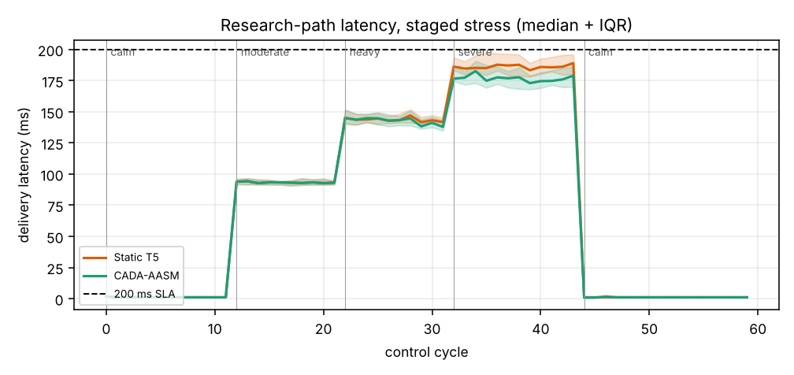
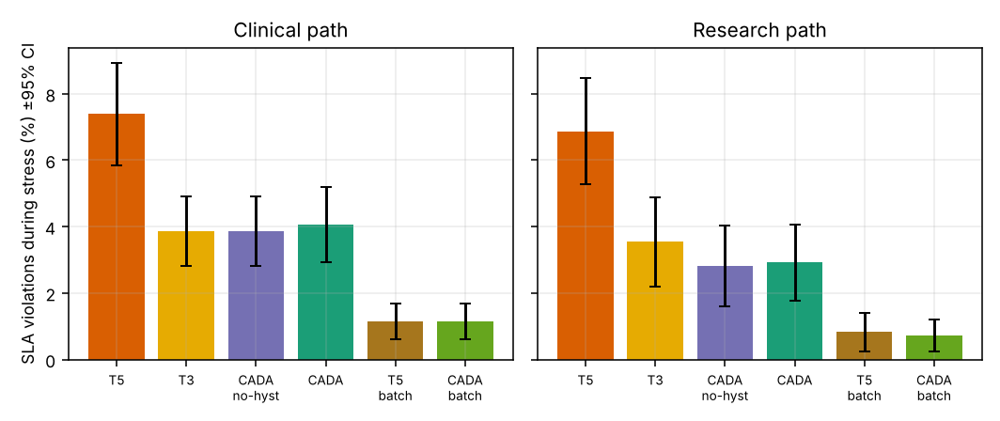
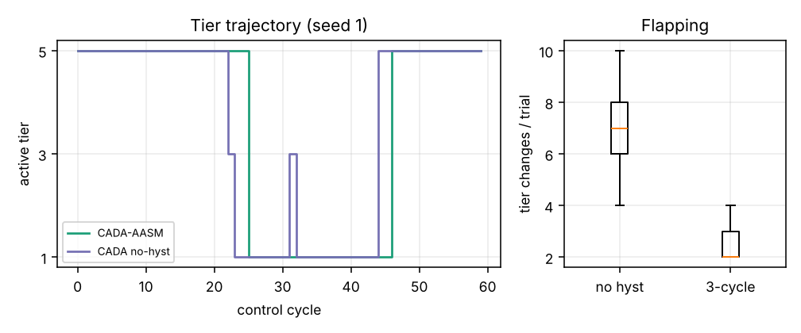
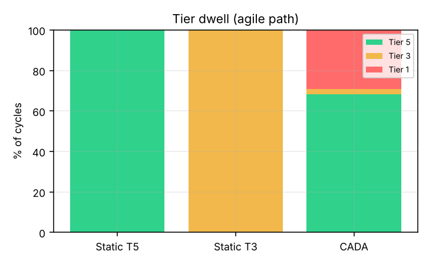
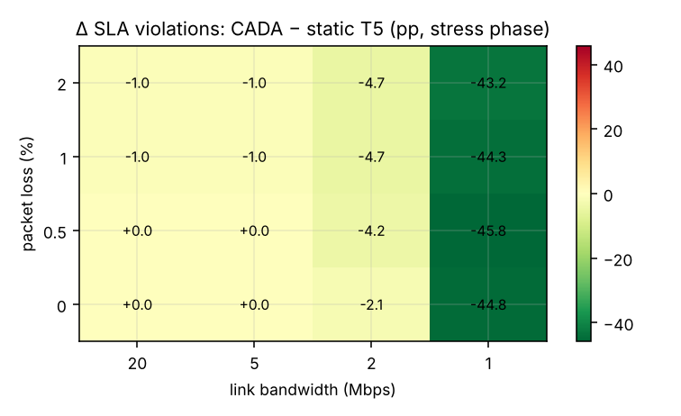

# Module 7 - Empirical Evaluation Report (Agile-HQ-PQC / CADA-AASM)

*30 paired trials (seeds 1..30); each trial = 60 control cycles: calm(12) -> moderate(10) -> heavy(10) -> severe(12) -> calm(16). Reproduce with `python evaluation/run_eval.py`.*

## 1. What is measured vs. modelled

- **Real**: hybrid handshakes, AEAD, Ed25519 and ML-KEM/ML-DSA operations (pure-Python reference libraries), wire sizes, controller logic, anonymisation.
- **Emulated (assumptions, not testbed data)**: congestion via `StressInjector` (extra RTT / CPU / loss / bandwidth) and the delivery-latency model `NetworkModel` = RTT + serialisation + per-extra-fragment queueing + one RTO if any fragment is lost.
- Host RTT/CPU probes are fixed baselines (0.2 ms, 5 %) during evaluation so parallel workers do not perturb the controller.
- ML-DSA compute and handshake compute are **not charged** to per-packet latency (re-key is make-before-break; the pure-Python implementations are not representative of native speed). Only their **bytes on the wire** are. This isolates the size/fragmentation mechanism the project is about, and means compute-bound effects are out of scope.
- Latency is delivery-and-acknowledge time, consistent with L = 200 - RTT - 0.5*CPU.

## 2. Part A - staged stress, mean ± 95% CI

| Metric | CADA-AASM | CADA no-hyst | Static T5 | Static T3 | CADA + batch-sign | Static T5 + batch-sign |
|---|---|---|---|---|---|---|
| Clinical SLA violations in stress (frac.) | 0.041 ± 0.011 | 0.039 ± 0.010 | 0.074 ± 0.015 | 0.039 ± 0.010 | 0.011 ± 0.005 | 0.011 ± 0.005 |
| Research SLA violations in stress (frac.) | 0.029 ± 0.011 | 0.028 ± 0.012 | 0.069 ± 0.016 | 0.035 ± 0.013 | 0.007 ± 0.005 | 0.008 ± 0.006 |
| Clinical p95 (ms) | 187.704 ± 2.067 | 187.399 ± 1.938 | 195.671 ± 2.543 | 187.335 ± 1.945 | 173.710 ± 1.729 | 172.602 ± 1.626 |
| Research p95 (ms) | 184.246 ± 2.765 | 185.081 ± 3.524 | 197.781 ± 7.765 | 187.083 ± 2.685 | 172.953 ± 1.906 | 172.200 ± 1.669 |
| Clinical p99 (ms) | 235.132 ± 17.433 | 234.752 ± 17.395 | 260.061 ± 21.999 | 234.545 ± 17.320 | 201.424 ± 10.330 | 202.585 ± 10.449 |
| Mean clinical wire bytes | 4609.868 ± 21.349 | 4546.906 ± 0.110 | 5030.159 ± 0.111 | 3712.172 ± 0.111 | 821.559 ± 4.171 | 942.981 ± 0.109 |
| Handshakes / trial | 6.400 ± 0.241 | 10.867 ± 0.577 | 2.000 ± 0.000 | 2.000 ± 0.000 | 6.400 ± 0.241 | 2.000 ± 0.000 |
| Tier changes / trial | 2.400 ± 0.241 | 6.867 ± 0.577 | 0.000 ± 0.000 | 0.000 ± 0.000 | 2.400 ± 0.241 | 0.000 ± 0.000 |
| Mean ε (agile path) | 0.373 ± 0.015 | 0.396 ± 0.006 | 0.100 ± 0.000 | 0.500 ± 0.000 | 0.373 ± 0.015 | 0.100 ± 0.000 |
| Mean K (agile path) | 4.072 ± 0.048 | 3.968 ± 0.012 | 5.000 ± 0.000 | 3.000 ± 0.000 | 4.072 ± 0.048 | 5.000 ± 0.000 |
| Min clinical tier | 3.000 ± 0.000 | 3.000 ± 0.000 | 5.000 ± 0.000 | 3.000 ± 0.000 | 3.000 ± 0.000 | 5.000 ± 0.000 |

## 3. Paired tests (first config minus second; Wilcoxon signed-rank p, paired-t p)

| Comparison | Metric | mean diff | Wilcoxon p | t p | d_z | Reading |
|---|---|---|---|---|---|---|
| adaptive_vs_static_t5 | viol_clinical_stress | -0.0333 | 6.03e-05 | 1.78e-06 | -1.09 | significantly better |
| adaptive_vs_static_t5 | viol_research_stress | -0.0396 | 2.87e-05 | 2.97e-07 | -1.21 | significantly better |
| adaptive_vs_static_t5 | p95_clinical | -7.9671 | 3.73e-09 | 1.40e-09 | -1.59 | significantly better |
| adaptive_vs_static_t5 | p95_research | -13.5356 | 1.86e-09 | 7.15e-04 | -0.69 | significantly better |
| adaptive_vs_static_t5 | tier_changes | +2.4000 | 5.88e-07 | 3.33e-18 | 3.56 | significantly worse |
| adaptive_vs_static_t5 | handshakes | +4.4000 | 5.88e-07 | 1.58e-25 | 6.52 | significantly worse |
| adaptive_vs_static_t3 | viol_clinical_stress | +0.0021 | 1.57e-01 | 1.61e-01 | 0.26 | no significant difference |
| adaptive_vs_static_t3 | viol_research_stress | -0.0063 | 5.78e-02 | 5.63e-02 | -0.36 | no significant difference |
| adaptive_vs_static_t3 | p95_clinical | +0.3685 | 5.70e-01 | 2.10e-01 | 0.23 | no significant difference |
| adaptive_vs_static_t3 | p95_research | -2.8372 | 2.05e-07 | 4.16e-10 | -1.68 | significantly better |
| adaptive_vs_static_t3 | tier_changes | +2.4000 | 5.88e-07 | 3.33e-18 | 3.56 | significantly worse |
| adaptive_vs_static_t3 | handshakes | +4.4000 | 5.88e-07 | 1.58e-25 | 6.52 | significantly worse |
| adaptive_vs_adaptive_nohyst | viol_clinical_stress | +0.0021 | 1.57e-01 | 1.61e-01 | 0.26 | no significant difference |
| adaptive_vs_adaptive_nohyst | viol_research_stress | +0.0010 | 7.05e-01 | 7.12e-01 | 0.07 | no significant difference |
| adaptive_vs_adaptive_nohyst | p95_clinical | +0.3050 | 4.77e-01 | 2.97e-01 | 0.19 | no significant difference |
| adaptive_vs_adaptive_nohyst | p95_research | -0.8356 | 7.15e-01 | 2.59e-01 | -0.21 | no significant difference |
| adaptive_vs_adaptive_nohyst | tier_changes | -4.4667 | 2.26e-06 | 8.48e-14 | -2.41 | significantly better |
| adaptive_vs_adaptive_nohyst | handshakes | -4.4667 | 2.26e-06 | 8.48e-14 | -2.41 | significantly better |
| adaptive_batch_vs_static_t5_batch | viol_clinical_stress | +0.0000 | 1.00e+00 | 1.00e+00 | 0.00 | no significant difference |
| adaptive_batch_vs_static_t5_batch | viol_research_stress | -0.0010 | 7.05e-01 | 7.12e-01 | -0.07 | no significant difference |
| adaptive_batch_vs_static_t5_batch | p95_clinical | +1.1077 | 4.97e-02 | 7.53e-02 | 0.34 | significantly worse |
| adaptive_batch_vs_static_t5_batch | p95_research | +0.7528 | 6.41e-01 | 2.68e-01 | 0.21 | no significant difference |
| adaptive_batch_vs_static_t5_batch | tier_changes | +2.4000 | 5.88e-07 | 3.33e-18 | 3.56 | significantly worse |
| adaptive_batch_vs_static_t5_batch | handshakes | +4.4000 | 5.88e-07 | 1.58e-25 | 6.52 | significantly worse |

## 4. Part B - where does steering help? (bandwidth × loss sweep)

Constant severe RTT/CPU stress, 4 seeds per cell, per-packet PQ signatures. Cell = CADA minus static-T5 SLA-violation rate (percentage points; negative = CADA better).

| loss \ bandwidth | 20 Mbps | 5 Mbps | 2 Mbps | 1 Mbps |
|---|---|---|---|---|
| 0 % | +0.0 (T5 1.0%) | +0.0 (T5 1.0%) | -2.1 (T5 6.2%) | -44.8 (T5 68.2%) |
| 0.5 % | +0.0 (T5 0.0%) | +0.0 (T5 0.0%) | -4.2 (T5 9.9%) | -45.8 (T5 71.9%) |
| 1 % | -1.0 (T5 4.7%) | -1.0 (T5 4.7%) | -4.7 (T5 14.1%) | -44.3 (T5 73.4%) |
| 2 % | -1.0 (T5 7.8%) | -1.0 (T5 7.8%) | -4.7 (T5 16.7%) | -43.2 (T5 73.4%) |

## 5. Invariants

- HIPAA floor: minimum clinical tier over all adaptive trials = **3** (required >= 3).
- Anti-flapping: tier changes / trial 2.4 (3-cycle hysteresis) vs 6.9 (none).
